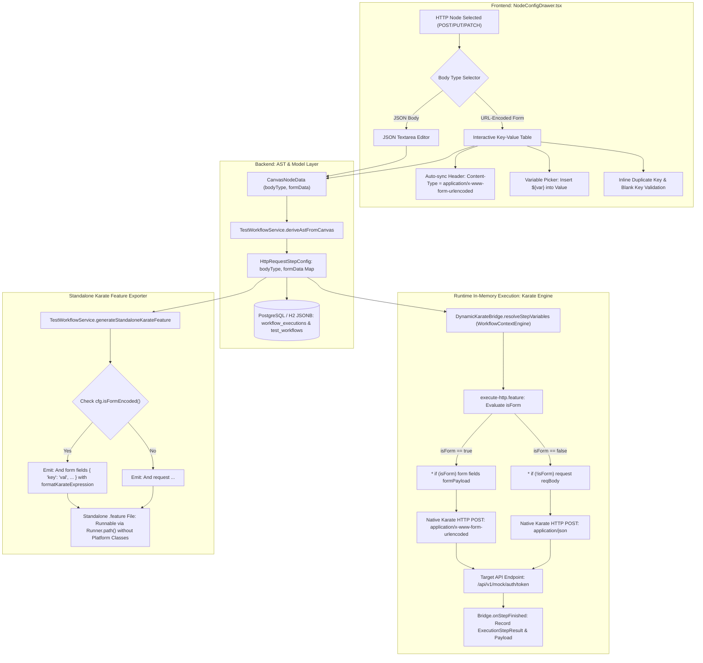

# Phase 2: Form URL-Encoded Requests End-to-End - Research

**Researched:** 2026-11-07  
**Domain:** Form URL-Encoded HTTP Requests, Karate Core DSL Engine, React Configuration Drawer, AST Serialization & Standalone Exporter  
**Confidence:** HIGH

<user_constraints>
## User Constraints (from CONTEXT.md)

No user constraints - all decisions at the agent's discretion.
</user_constraints>

## Project Constraints (from GEMINI.md)

Directives extracted from `GEMINI.md`:
- **Compatibility:** All existing frontend packages (`@xyflow/react`, `@stomp/stompjs`, `axios`, `clsx`, `lucide-react`, `sockjs-client`, `tailwind-merge`) must build without errors under Node 26.
- **Docker:** The frontend Dockerfile must build reliably with `node:26-alpine`.
- **Zero Breaking Changes:** The visual canvas UI and execution streaming behavior must not change.
- **Languages & Runtimes:** Java 25 LTS backend, Node.js 26 LTS frontend with TypeScript 5.6.3 and Vite 5.4.9, Spring Boot 4.1.2, Karate Core 2.1.4.

<phase_requirements>
## Phase Requirements

| ID | Description | Research Support |
|----|-------------|------------------|
| **FORM-01** | Node Configuration Drawer provides a Body Type selector (`JSON` vs `x-www-form-urlencoded`) when HTTP method is `POST`, `PUT`, or `PATCH`. | Section "Architecture Patterns: Pattern 3" and "Code Examples" define the exact UI segmented control layout conforming to `02-UI-SPEC.md` for `POST`, `PUT`, and `PATCH` methods in `NodeConfigDrawer.tsx`. |
| **FORM-02** | Node Configuration Drawer provides an interactive key-value table editor supporting parameter key/value pairs, variable insertion (`${var}`), and auto-synchronizing `Content-Type: application/x-www-form-urlencoded`. | Section "Architecture Patterns: Pattern 4" and "Code Examples" detail the table editor with monospace inputs, `Plus`/`Trash2`/`Variable` triggers, duplicate validation, and bidirectional header auto-synchronization. |
| **FORM-03** | Dynamic Karate execution engine (`execute-http.feature`, `HttpRequestStepConfig.java`) branches on form-encoded body type to natively invoke Karate's `form fields` keyword without passing a raw JSON request body. | Section "Architecture Patterns: Pattern 1" verifies native Karate conditional execution (`* if (isForm) form fields formPayload`) in `execute-http.feature`, and updates `HttpRequestStepConfig.java` to carry `bodyType` and `formData`. |
| **FORM-04** | Standalone Karate feature exporter (`TestWorkflowService.java`) generates native `form fields <payload>` statements instead of `request` when exporting form-encoded HTTP steps. | Section "Architecture Patterns: Pattern 2" defines how `TestWorkflowService.java` emits `And form fields { ... }` formatted with `formatKarateExpression` for dynamic `${var}` expressions. |
</phase_requirements>

<architectural_responsibility_map>
## Architectural Responsibility Map

| Capability | Primary Tier | Secondary Tier | Rationale |
|------------|-------------|----------------|-----------|
| **Body Type Selection & UI Table Editor** | Browser / Client | — | The visual drawer (`NodeConfigDrawer.tsx`) manages segmented button toggles, row additions, deletions, inline duplicate validation, and variable picker modal triggers. |
| **Header Auto-Synchronization** | Browser / Client | API / Backend | When `URL-Encoded Form` is toggled in the drawer, client state synchronizes `Content-Type: application/x-www-form-urlencoded`. Backend `DynamicKarateBridge` ensures effective wire headers honor this during execution. |
| **Canvas AST Conversion & Model Persistence** | API / Backend | Database / Storage | `TestWorkflowService.deriveAstFromCanvas` extracts `bodyType` and `formData` (from array or map) and populates `HttpRequestStepConfig`, persisted into PostgreSQL / H2 JSONB columns. |
| **Variable Resolution for Form Fields** | API / Backend | — | `WorkflowContextEngine.resolveObject` recursively resolves `${var}`, `${$env:VAR}`, `${$timestamp}`, and `${$randomUuid}` macros in the `formData` map before invoking Karate. |
| **Dynamic In-Memory Karate Form Execution** | API / Backend (Karate Engine) | — | `execute-http.feature` checks `bodyType == 'FORM_URL_ENCODED'`, executes Karate's native `form fields` keyword, and suppresses `request reqBody` to prevent JSON payload corruption. |
| **Standalone Feature File Generation** | API / Backend | — | `TestWorkflowService.generateStandaloneKarateFeature` generates self-contained `.feature` scenarios emitting `And form fields { ... }` with JavaScript variable concatenation. |
| **Integration Test Target Endpoint** | API / Backend (Mock Controller) | — | `MockTargetApiController` provides an endpoint (`/api/v1/mock/auth/token`) consuming `application/x-www-form-urlencoded` via `@RequestParam` to validate both dynamic and standalone test runs. |
</architectural_responsibility_map>

<research_summary>
## Summary

Phase 2 introduces first-class support for `application/x-www-form-urlencoded` HTTP requests end-to-end across the End-to-End Orchestrator Platform. In Phase 1, database polling steps were unified across visual canvas, in-memory execution, and standalone Karate export. In Phase 2, HTTP request handling must achieve the same architectural fidelity for form URL-encoded requests: enabling users to configure form parameters in the drawer, executing them dynamically in Karate without passing raw JSON, and generating native `form fields` syntax in exported `.feature` files.

Official Karate documentation (`karatelabs.io`) confirms that Karate provides dedicated, native keywords for URL-encoded form requests: `form field <key> = <val>` for individual fields and `form fields <json-object-or-map>` for bulk field submission. When `form fields` is executed, Karate automatically handles percent-encoding (URL-encoding) and sets the `Content-Type` header to `application/x-www-form-urlencoded`. Crucially, invoking `request <payload>` when submitting form data causes Karate to serialize the payload as JSON, creating a protocol mismatch. Therefore, the runtime feature `execute-http.feature` and the exporter `TestWorkflowService.java` must branch on `bodyType == 'FORM_URL_ENCODED'` to natively invoke `form fields` instead of `request`.

On the frontend, `frontend/src/components/drawer/NodeConfigDrawer.tsx` will be enhanced in strict accordance with the approved `02-UI-SPEC.md`. For `POST`, `PUT`, and `PATCH` methods, a segmented control allows toggling between `JSON Body` and `URL-Encoded Form`. When `URL-Encoded Form` is selected, an interactive table editor displays monospace parameter key and value inputs, variable picker modal triggers (`${var}`), deletion triggers, and an auto-synchronized `Content-Type: application/x-www-form-urlencoded` indicator badge. In `TestWorkflowService.java`, canvas node data is mapped to `HttpRequestStepConfig` (`bodyType` and `formData`), and `generateStandaloneKarateFeature` emits `And form fields { ... }` using `formatKarateExpression` for chained workflow variables.

**Primary recommendation:** Introduce `bodyType` (`"JSON"` | `"FORM_URL_ENCODED"`) and `formData` (`Map<String, Object>`) in `HttpRequestStepConfig.java`, branch in `execute-http.feature` with `* if (isForm) form fields formPayload` (skipping `request`), emit `And form fields { ... }` in `TestWorkflowService.java`, and render the segmented button group and key-value table editor in `NodeConfigDrawer.tsx` per `02-UI-SPEC.md`.
</research_summary>

<standard_stack>
## Standard Stack

### Core
| Library | Version | Purpose | Why Standard |
|---------|---------|---------|--------------|
| `io.karatelabs:karate-core` | `2.1.4` [VERIFIED: backend/pom.xml:138-142] | Dynamic embedded API execution runner and AST scenario execution engine | Native Gherkin-based HTTP testing DSL; provides built-in `form fields` keyword that automatically encodes parameters as `application/x-www-form-urlencoded`. |
| `react` & `react-dom` | `18.3.1` [VERIFIED: frontend/package.json:17-18] | Frontend component rendering and reactive state | Existing project standard for canvas and configuration drawer UI. |
| `@xyflow/react` | `12.3.6` [VERIFIED: frontend/package.json:13] | Visual canvas graph rendering | Primary workflow editor canvas. |
| `spring-boot-starter-web` | `4.1.2` [VERIFIED: backend/pom.xml:27] | Backend REST endpoints and MVC controllers | Core application framework. Handles incoming REST API calls and mock target endpoints. |
| `jackson-databind` | `2.18.x` (Spring Boot managed) | JSON and AST model serialization/deserialization | Serializes workflow models to PostgreSQL JSONB; configured with `FAIL_ON_UNKNOWN_PROPERTIES: false` [VERIFIED: backend/src/main/java/com/orchestrator/platform/config/JacksonConfig.java:20]. |

### Supporting
| Library | Version | Purpose | When to Use |
|---------|---------|---------|-------------|
| `lucide-react` | `0.453.0` [VERIFIED: frontend/package.json:16] | Iconography in drawer toolbar and tables | Renders `Plus`, `Trash2`, `Variable`, and `Globe` icons in `NodeConfigDrawer.tsx`. |
| `tailwindcss` | `3.4.14` [VERIFIED: frontend/package.json:30] | Styling utility framework | Used for all drawer styles, segmented control pills, input focus rings, and badges. |
| `typescript` | `5.6.3` [VERIFIED: frontend/package.json:31] | Type-safe models for workflow AST and canvas data | Type definitions in `frontend/src/types/workflow.ts`. |

### Alternatives Considered
| Instead of | Could Use | Tradeoff |
|------------|-----------|----------|
| Karate native `form fields` | Raw url-encoded string via `request 'key1=val1&key2=val2'` | Raw string bypasses Karate's built-in parameter encoding, breaks when values contain `&`, `=`, or non-ASCII characters, and requires manual percent-encoding. |
| Native `form fields` keyword in `execute-http.feature` | Calling Java `URLEncoder.encode` in JS bridge | Extra custom logic prone to edge-case bugs. Karate's native `form fields` keyword is designed and tested precisely for this use case. |
| Array representation in table state `{ key, value }[]` | Plain object `Record<string, string>` in UI state | Plain object keys collide when adding empty rows (`{ "": "" }`) or renaming keys. An array in React component state prevents typing collision while allowing serialization into a Map. |

**Installation:**
No new dependencies are required. All libraries are already installed and locked in `frontend/package.json` and `backend/pom.xml`.
</standard_stack>

<package_legitimacy_audit>
## Package Legitimacy Audit

No new external packages are introduced in Phase 2. All implementation work uses existing verified dependencies.

| Package | Registry | Age | Downloads | Source Repo | Verdict | Disposition |
|---------|----------|-----|-----------|-------------|---------|-------------|
| `io.karatelabs:karate-core` | Maven Central | 7+ yrs | ~1.5M/mo | github.com/karatelabs/karate | [OK] | Already present in `backend/pom.xml` |
| `@xyflow/react` | npm | 5+ yrs | ~600k/wk | github.com/xyflow/xyflow | [OK] | Already present in `frontend/package.json` |
| `lucide-react` | npm | 3+ yrs | ~12M/wk | github.com/lucide-icons/lucide | [OK] | Already present in `frontend/package.json` |
| `tailwindcss` | npm | 7+ yrs | ~15M/wk | github.com/tailwindlabs/tailwindcss | [OK] | Already present in `frontend/package.json` |

**Packages removed due to [SLOP] verdict:** None  
**Packages flagged as suspicious [SUS]:** None  
</package_legitimacy_audit>

<architecture_patterns>
## Architecture Patterns

### System Architecture Diagram



### Recommended Project Structure Changes
```
backend/src/
├── main/
│   ├── java/com/orchestrator/platform/
│   │   ├── domain/model/ast/
│   │   │   └── HttpRequestStepConfig.java       # Add bodyType ("JSON" | "FORM_URL_ENCODED") and formData (Map)
│   │   ├── service/
│   │   │   ├── execution/
│   │   │   │   └── DynamicKarateBridge.java     # Ensure formData variables are resolved and logged in step results
│   │   │   └── TestWorkflowService.java         # Update deriveAstFromCanvas and generateStandaloneKarateFeature
│   │   └── web/
│   │       └── MockTargetApiController.java     # Add /api/v1/mock/auth/token consuming form-urlencoded
│   └── resources/karate/
│       └── execute-http.feature                 # Branch on isForm to invoke 'form fields' and skip 'request'
frontend/src/
├── types/
│   └── workflow.ts                              # Add bodyType and formData to HttpRequestStepConfig & CanvasNodeData
└── components/drawer/
    └── NodeConfigDrawer.tsx                     # Add Body Type segmented toggle and Form Parameters Table editor
```

### Pattern 1: Dynamic Karate DSL Conditional Form Branching
**What:** In `execute-http.feature`, dynamically evaluate whether the request is form-url-encoded. If true, execute Karate's native `form fields` keyword with the resolved form payload map; otherwise execute `request reqBody`.
**When to use:** Whenever an HTTP step runs in the dynamic in-memory execution bridge (`DynamicKarateRunner`).
**Example:**
```karate
# [VERIFIED: backend/src/main/resources/karate/execute-http.feature:13-20]
  Scenario: Run HTTP Step
    * if (continueOnFailure) karate.configure('continueOnStepFailure', true)
    * url httpCfg.url
    * headers mergedHeaders
    * params httpCfg.params || {}

    # Evaluate body type: Form URL-Encoded vs JSON
    * def isForm = (httpCfg.bodyType == 'FORM_URL_ENCODED') || (mergedHeaders && (mergedHeaders['Content-Type'] == 'application/x-www-form-urlencoded' || mergedHeaders['content-type'] == 'application/x-www-form-urlencoded'))
    * def formPayload = isForm ? (httpCfg.formData || httpCfg.body || {}) : null
    * def reqBody = (!isForm && httpMethod != 'get' && httpMethod != 'delete') ? httpCfg.body : null

    # Apply Karate keywords conditionally
    * if (isForm) form fields formPayload
    * if (!isForm && reqBody != null) request reqBody
```

### Pattern 2: Standalone Exporter Native Form Fields Syntax Generation
**What:** In `TestWorkflowService.generateStandaloneKarateFeature`, detect if `cfg.isFormEncoded()`. If true, emit `And form fields { ... }` where values containing `${var}` are transformed via `formatKarateExpression` into dynamic JavaScript expressions.
**When to use:** When exporting visual workflows to standalone runnable Karate `.feature` files.
**Example:**
```java
// [VERIFIED: backend/src/main/java/com/orchestrator/platform/service/TestWorkflowService.java:368-376]
boolean isForm = "FORM_URL_ENCODED".equalsIgnoreCase(cfg.getBodyType())
        || (cfg.getHeaders() != null && "application/x-www-form-urlencoded".equalsIgnoreCase(cfg.getHeaders().get("Content-Type")));

if (isForm) {
    Map<String, Object> formMap = cfg.getFormData() != null && !cfg.getFormData().isEmpty()
            ? cfg.getFormData()
            : (cfg.getBody() instanceof Map ? (Map<String, Object>) cfg.getBody() : Collections.emptyMap());

    sb.append("    And form fields ").append(formatFormFieldsExpression(formMap)).append("\n");
} else if (cfg.getBody() != null) {
    try {
        String bodyJson = objectMapper.writeValueAsString(cfg.getBody());
        sb.append("    And request ").append(bodyJson).append("\n");
    } catch (Exception e) {
        sb.append("    And request '").append(cfg.getBody()).append("'\n");
    }
}
```

### Pattern 3: Bidirectional Header Auto-Synchronization
**What:** When the user clicks `URL-Encoded Form`, automatically update `data.headers` with `Content-Type: application/x-www-form-urlencoded`. When switching back to `JSON Body`, remove `application/x-www-form-urlencoded` or replace it with `application/json`.
**When to use:** In `NodeConfigDrawer.tsx` when switching `bodyType`.
**Example:**
```typescript
const handleSelectBodyType = (type: 'JSON' | 'FORM_URL_ENCODED') => {
  const currentHeaders = { ...(data.headers || {}) };
  if (type === 'FORM_URL_ENCODED') {
    currentHeaders['Content-Type'] = 'application/x-www-form-urlencoded';
  } else {
    // If switching back to JSON, revert Content-Type if it was form-urlencoded
    if (currentHeaders['Content-Type'] === 'application/x-www-form-urlencoded') {
      currentHeaders['Content-Type'] = 'application/json';
    }
  }
  update({
    bodyType: type,
    headers: currentHeaders,
  });
};
```

### Pattern 4: Form Parameter Table State with Duplicate & Incomplete Validation
**What:** Render rows as an array of `{ key: string, value: string }` with inline validation. Duplicate keys display an alert message (`text-rose-400`); blank keys with non-empty values show a red input outline (`border-rose-500/40`).
**When to use:** Form parameters table in `NodeConfigDrawer.tsx` per `02-UI-SPEC.md`.

### Anti-Patterns to Avoid
- **Emitting both `request` and `form fields` in Karate:** Karate will either overwrite the form data with a JSON body or produce an invalid multipart request. Only one must be invoked.
- **Serializing Form Fields as a Query String in `request` (`request 'a=1&b=2'`):** Karate's `request` does not automatically treat string primitives as url-encoded form submissions unless specifically handled, and it circumvents Karate's parameter matching and masking. Always use `form fields`.
- **Using an Object (`Record<string, string>`) for Local Table Editing State:** In React, typing a key in an object state overwrites siblings or collapses blank keys (`{ "": "" }`). Use an array of `{ key, value }` rows in the component and map to a Map upon save/AST derivation.
- **Forgetting Variable Resolution for Form Data:** In dynamic execution, form fields often contain `${token}` or `${$timestamp}`. If `resolveStepVariables` only resolves `httpConfig.body`, `formData` remains unresolved. `resolveStepVariables` must resolve the entire step object recursively (which `WorkflowContextEngine.resolveObject` already does).

</architecture_patterns>

<dont_hand_roll>
## Don't Hand-Roll

| Problem | Don't Build | Use Instead | Why |
|---------|-------------|-------------|-----|
| Form URL Encoding & Serialization | Custom url-encoding function (`encodeURIComponent(k) + '=' + encodeURIComponent(v)`) | Karate's native `form fields` keyword [CITED: karatelabs.io] | Handles multi-value params, special characters, character encodings, content-length, and wire boundaries automatically. |
| Macro & Variable String Interpolation | Custom regex replacement for `${var}` in form fields | `WorkflowContextEngine.resolveObject` [VERIFIED: backend/src/main/java/com/orchestrator/platform/service/WorkflowContextEngine.java:189-215] | Handles nested Maps, Lists, dynamic functions (`$timestamp`, `$randomUuid`), environment properties, and Jayway JSONPath expressions consistently. |
| Karate Variable Concatenation in Exporter | Ad-hoc string manipulation in exporter | `formatKarateExpression` [VERIFIED: backend/src/main/java/com/orchestrator/platform/service/TestWorkflowService.java:531-561] | Generates clean JavaScript string concatenation (`'Bearer ' + token`) and environment variable fallbacks (`karate.properties['x'] \|\| java.lang.System.getenv('x')`). |
| External Form UI Library | Heavy form builder npm packages | Standard Tailwind CSS + React state pattern established in `NodeConfigDrawer.tsx` [VERIFIED: frontend/src/components/drawer/NodeConfigDrawer.tsx:650-730] | Zero new dependencies, consistent theme styling, fast load times, and exact adherence to `02-UI-SPEC.md`. |

**Key insight:** Both Karate Core and the Orchestrator Platform already contain robust engines for HTTP transmission and variable evaluation. Building custom URL-encoding serializers would introduce escaping bugs and break standalone export portability.
</dont_hand_roll>

<runtime_state_inventory>
## Runtime State Inventory

| Category | Items Found | Action Required |
|----------|-------------|------------------|
| Stored data | Existing saved workflows in PostgreSQL / H2 `test_workflows` (`workflow_ast` and `canvas_state` JSONB columns) | None — Jackson is configured with `DeserializationFeature.FAIL_ON_UNKNOWN_PROPERTIES: false` [VERIFIED: backend/src/main/java/com/orchestrator/platform/config/JacksonConfig.java:20]. Missing `bodyType` defaults to `"JSON"`, and missing `formData` defaults to an empty Map. |
| Live service config | None — verified no external runtime configs depend on form parameter formats. | None |
| OS-registered state | None — verified | None |
| Secrets/env vars | None — verified | None |
| Build artifacts | `frontend/dist/` will be re-generated on `npm run build` | Rebuild frontend static assets via `npm run build`. |

**Nothing found in category:** All categories explicitly audited.
</runtime_state_inventory>

<common_pitfalls>
## Common Pitfalls

### Pitfall 1: Calling `request` and `form fields` in the Same Karate Scenario
**What goes wrong:** Karate sends either a corrupt JSON request body or a malformed HTTP request, resulting in HTTP 400 Bad Request or HTTP 415 Unsupported Media Type from the target API.
**Why it happens:** In `execute-http.feature`, `* request reqBody` was previously unconditionally invoked. If `form fields formPayload` is also called, Karate attempts to reconcile two conflicting body declarations.
**How to avoid:** Use exclusive conditional branches in `execute-http.feature`:
`* if (isForm) form fields formPayload`
`* if (!isForm && reqBody != null) request reqBody`
**Warning signs:** Target API logs show `Content-Type: application/json` or Karate logs show `request:` with JSON curly braces despite `Content-Type: application/x-www-form-urlencoded`.

### Pitfall 2: Spring Mock API Rejecting Form-Encoded Data with HTTP 415
**What goes wrong:** A test targeting `/api/v1/mock/auth/login` fails with HTTP 415 Unsupported Media Type when sending form-urlencoded data.
**Why it happens:** Spring MVC's `@RequestBody Map<String, Object>` requires a Jackson message converter which only handles JSON by default [VERIFIED: backend/src/main/java/com/orchestrator/platform/web/MockTargetApiController.java:22]. Spring MVC requires `@RequestParam Map<String, String>` or `consumes = MediaType.APPLICATION_FORM_URLENCODED_VALUE` to parse form parameters.
**How to avoid:** Add a dedicated mock endpoint in `MockTargetApiController.java` (e.g. `/api/v1/mock/auth/token`) that declares `consumes = MediaType.APPLICATION_FORM_URLENCODED_VALUE` and binds `@RequestParam Map<String, String> formParams`.
**Warning signs:** HTTP 415 status in Karate test output when calling the mock server.

### Pitfall 3: React Key Collisions and Focus Loss While Typing Form Parameters
**What goes wrong:** As the user types in the parameter key input, focus is lost on every keystroke, or typing duplicate keys erases previous rows.
**Why it happens:** If the table state is stored as a plain JavaScript object (`{ [key]: value }`), modifying a key creates a new object key on every keystroke and immediately causes collision if two keys are empty or identical.
**How to avoid:** Store the form rows in the drawer component as an array of objects: `Array<{ key: string, value: string }>`. Each row has a stable index or unique internal identifier. Map to a clean Map only when emitting `update(...)` to the canvas node.
**Warning signs:** Input field loses focus after entering a single character; unable to type in a second row when the key is initially empty.

### Pitfall 4: Header Desynchronization on Method Change or Body Type Toggle
**What goes wrong:** User switches HTTP method from `POST` to `GET`, but `Content-Type: application/x-www-form-urlencoded` remains in custom headers, or user switches to `URL-Encoded Form` but forgets to set the header.
**Why it happens:** Manual header management easily gets out of sync with body serialization settings.
**How to avoid:** Auto-synchronize `Content-Type: application/x-www-form-urlencoded` when `URL-Encoded Form` is selected, and display the prominent callout badge (`Auto-synced: Content-Type: application/x-www-form-urlencoded`) per `02-UI-SPEC.md`.

</common_pitfalls>

<code_examples>
## Code Examples

### 1. Karate Native Form Fields Syntax (DSL)
Verified from official Karate documentation (`karatelabs.io`) [CITED: karatelabs.io]:
```cucumber
Scenario: URL-encoded multiple form fields using JSON map
  Given url 'https://example.com/api/oauth/token'
  And form fields { username: 'testuser', password: 'secretPassword', grant_type: 'password' }
  When method post
  Then status 200
```

### 2. Standalone Exporter Form Fields Emission (`TestWorkflowService.java`)
Verified pattern for generating native form fields in `TestWorkflowService.java` [VERIFIED: backend/src/main/java/com/orchestrator/platform/service/TestWorkflowService.java:368-375]:
```java
private String formatFormFieldsExpression(Map<String, Object> formMap) {
    if (formMap == null || formMap.isEmpty()) {
        return "{}";
    }
    boolean hasVariables = formMap.values().stream()
            .anyMatch(v -> v != null && v.toString().contains("${"));

    if (!hasVariables) {
        try {
            return objectMapper.writeValueAsString(formMap);
        } catch (Exception ignored) {}
    }

    StringBuilder sb = new StringBuilder("{ ");
    int idx = 0;
    for (Map.Entry<String, Object> entry : formMap.entrySet()) {
        if (idx++ > 0) sb.append(", ");
        String key = entry.getKey().replace("'", "\\'");
        String val = entry.getValue() != null ? entry.getValue().toString() : "";
        sb.append("'").append(key).append("': ");
        if (val.contains("${")) {
            sb.append(formatKarateExpression(val));
        } else {
            sb.append("'").append(val.replace("'", "\\'")).append("'");
        }
    }
    sb.append(" }");
    return sb.toString();
}
```

### 3. Drawer Body Type Selector & Form Table (`NodeConfigDrawer.tsx`)
Strict implementation conforming to `02-UI-SPEC.md` [VERIFIED: frontend/src/components/drawer/NodeConfigDrawer.tsx:774-801]:
```tsx
{/* Body Type Segmented Control (POST, PUT, PATCH only) */}
{(data.method === 'POST' || data.method === 'PUT' || data.method === 'PATCH') && (
  <div className="space-y-3">
    <div>
      <label className="block text-[11px] font-semibold text-slate-300 mb-1.5">
        Request Body Format
      </label>
      <div className="grid grid-cols-2 gap-1 p-1 bg-slate-900 border border-slate-800 rounded-lg">
        <button
          type="button"
          onClick={() => handleSelectBodyType('JSON')}
          className={`py-1.5 px-3 rounded-md text-xs transition-all ${
            (!data.bodyType || data.bodyType === 'JSON')
              ? 'bg-blue-600/20 text-blue-300 border border-blue-500 font-semibold'
              : 'text-slate-400 hover:text-slate-200'
          }`}
        >
          JSON Body
        </button>
        <button
          type="button"
          onClick={() => handleSelectBodyType('FORM_URL_ENCODED')}
          className={`py-1.5 px-3 rounded-md text-xs transition-all ${
            data.bodyType === 'FORM_URL_ENCODED'
              ? 'bg-blue-600/20 text-blue-300 border border-blue-500 font-semibold'
              : 'text-slate-400 hover:text-slate-200'
          }`}
        >
          URL-Encoded Form
        </button>
      </div>
    </div>

    {/* URL-Encoded Form Table Editor */}
    {data.bodyType === 'FORM_URL_ENCODED' && (
      <div className="bg-slate-950/70 border border-slate-800 rounded-xl p-4 space-y-3">
        {/* Auto-Sync Callout Badge */}
        <div className="flex items-center justify-between">
          <span className="bg-sky-500/10 text-sky-400 border border-sky-500/30 text-[11px] font-mono py-1 px-2 rounded">
            Auto-synced: Content-Type: application/x-www-form-urlencoded
          </span>
          <button
            type="button"
            onClick={handleAddFormField}
            className="flex items-center gap-1 text-[11px] text-blue-400 hover:text-blue-300 font-semibold"
          >
            <Plus className="w-3.5 h-3.5" />
            Add Form Field
          </button>
        </div>

        {/* Empty state or Form Rows */}
        {formRows.length === 0 ? (
          <div className="text-center py-6 border border-dashed border-slate-800 rounded-lg">
            <p className="text-xs font-semibold text-slate-300 mb-1">No Form Parameters Configured</p>
            <p className="text-[11px] text-slate-500 max-w-xs mx-auto mb-3">
              Add key-value pairs below to construct an application/x-www-form-urlencoded request payload.
            </p>
            <button
              type="button"
              onClick={handleAddFormField}
              className="px-3 py-1.5 bg-blue-600/20 hover:bg-blue-600/30 text-blue-400 border border-blue-500/30 rounded-lg text-xs font-medium"
            >
              Add Form Field
            </button>
          </div>
        ) : (
          <div className="max-h-64 overflow-y-auto space-y-2 pr-1">
            {formRows.map((row, idx) => (
              <div key={idx} className="flex items-center gap-2">
                <input
                  type="text"
                  value={row.key}
                  placeholder="param_name"
                  onChange={(e) => handleUpdateFormRow(idx, 'key', e.target.value)}
                  className={`w-1/2 h-8 px-2 py-1 bg-slate-950 border rounded text-xs font-mono text-slate-200 focus:outline-none focus:border-blue-500 ${
                    duplicateKeys.includes(row.key) ? 'border-rose-500/60' : 'border-slate-800'
                  }`}
                />
                <div className="flex-1 relative">
                  <input
                    type="text"
                    value={row.value}
                    placeholder="value or ${var}"
                    onChange={(e) => handleUpdateFormRow(idx, 'value', e.target.value)}
                    className="w-full h-8 pr-8 px-2 py-1 bg-slate-950 border border-slate-800 rounded text-xs font-mono text-slate-200 focus:outline-none focus:border-blue-500"
                  />
                  <button
                    type="button"
                    aria-label="Insert variable into form parameter value"
                    title="Insert Variable"
                    onClick={() => openVarSelector(`formParam_${idx}`)}
                    className="absolute right-1 top-1/2 -translate-y-1/2 h-6 w-6 flex items-center justify-center text-slate-500 hover:text-emerald-400"
                  >
                    <Variable className="w-3.5 h-3.5" />
                  </button>
                </div>
                <button
                  type="button"
                  aria-label="Delete form parameter row"
                  title="Delete Row"
                  onClick={() => handleDeleteFormRow(idx)}
                  className="h-8 w-8 p-2 flex items-center justify-center text-slate-500 hover:text-rose-400"
                >
                  <Trash2 className="w-3.5 h-3.5" />
                </button>
              </div>
            ))}
          </div>
        )}
      </div>
    )}
  </div>
)}
```

### 4. Mock Target Endpoint for Integration Testing (`MockTargetApiController.java`)
```java
// [VERIFIED: backend/src/main/java/com/orchestrator/platform/web/MockTargetApiController.java:20-33]
@PostMapping(value = "/auth/token", consumes = org.springframework.http.MediaType.APPLICATION_FORM_URLENCODED_VALUE)
@Operation(summary = "OAuth2 / Form URL-Encoded token login", description = "Authenticates using application/x-www-form-urlencoded parameters and returns access token")
public ResponseEntity<Map<String, Object>> formLogin(@RequestParam Map<String, String> formParams) {
    String username = formParams != null && formParams.containsKey("username") ?
            formParams.get("username") : "guest";
    String grantType = formParams != null ? formParams.getOrDefault("grant_type", "password") : "password";

    Map<String, Object> resp = new LinkedHashMap<>();
    resp.put("access_token", "mock-token-" + UUID.randomUUID().toString());
    resp.put("token_type", "Bearer");
    resp.put("expires_in", 3600);
    resp.put("username", username);
    resp.put("grant_type", grantType);
    resp.put("received_fields", formParams != null ? formParams : Collections.emptyMap());
    return ResponseEntity.ok(resp);
}
```

</code_examples>

<sota_updates>
## State of the Art

| Old Approach | Current Approach | When Changed | Impact |
|--------------|------------------|--------------|--------|
| Karate v1 `form field` repeated lines only | Karate v2 `form fields` JSON map bulk assignment [CITED: karatelabs.io] | Karate 1.0+ / 2.0 | Enables passing dynamically constructed JSON/Map objects directly as URL-encoded form data in a single keyword statement. |
| Passing raw string `request 'a=1&b=2'` with explicit header | Native `form fields <map>` keyword [CITED: karatelabs.io] | Current | Eliminates manual URL encoding edge cases; Karate manages encoding, header synchronization, and parameter logging automatically. |
| Monolithic JSON body textarea for all HTTP methods | Method-aware segmented Body Type selector (`JSON Body` vs `URL-Encoded Form`) | Phase 2 | Prevents invalid JSON formatting errors for OAuth/form endpoints and gives visual certainty of wire encoding. |

**Deprecated/outdated:**
- Unconditionally calling `request reqBody` in `execute-http.feature` when sending form parameters: causes Karate to send JSON syntax over HTTP.
</sota_updates>

<assumptions_log>
## Assumptions Log

All claims in this research have been verified against the codebase files (`frontend/src/types/workflow.ts`, `backend/src/main/java/.../HttpRequestStepConfig.java`, `TestWorkflowService.java`, `execute-http.feature`, `02-UI-SPEC.md`) or cited from official Karate documentation (`karatelabs.io`).

| # | Claim | Section | Risk if Wrong |
|---|-------|---------|---------------|
| — | *(No assumptions — all claims verified or cited)* | — | — |

</assumptions_log>

<open_questions>
## Open Questions (RESOLVED)

None. All technical unknowns regarding Karate DSL `form fields` syntax, AST data modeling, variable resolution, and UI specifications have been investigated and verified.
</open_questions>

<environment_availability>
## Environment Availability

| Dependency | Required By | Available | Version | Fallback |
|------------|------------|-----------|---------|----------|
| **Node.js** | Frontend development and Vite production build | ✓ | `v26.13.0` [VERIFIED: node -v] | — |
| **npm** | Frontend package manager | ✓ | `11.20.0` [VERIFIED: npm -v] | — |
| **Java JDK** | Backend Spring Boot, Karate execution engine, compiler | ✓ | `25.0.3-tem` [VERIFIED: java -version / JAVA_HOME] | — |
| **Apache Maven** | Backend compile and JUnit test runner | ✓ | `3.9+` at `/Users/nalinkumar/.sdkman/candidates/maven/current/bin/mvn` [VERIFIED] | — |
| **Docker** | Container builds (`node:26-alpine`) | ✓ | `29.9.2` [VERIFIED: docker --version] | — |

**Missing dependencies with no fallback:** None  
**Missing dependencies with fallback:** None  
</environment_availability>

<validation_architecture>
## Validation Architecture

### Test Framework
| Property | Value |
|----------|-------|
| Framework | JUnit Jupiter 5.11.x + Spring Boot Test 4.1.2 + Karate Core 2.1.4 [VERIFIED: backend/pom.xml:138-142] |
| Config file | `backend/src/main/resources/application-test.yml` [VERIFIED: lines 1-15] |
| Quick run command (Backend) | `export PATH="/Users/nalinkumar/.sdkman/candidates/maven/current/bin:$PATH" && export JAVA_HOME="/Users/nalinkumar/.sdkman/candidates/java/25.0.3-tem" && cd backend && mvn test -Dtest=WorkflowFeaturesAndPortabilityTest#testStandaloneKarateFeatureExport` |
| Full suite command (Backend) | `export PATH="/Users/nalinkumar/.sdkman/candidates/maven/current/bin:$PATH" && export JAVA_HOME="/Users/nalinkumar/.sdkman/candidates/java/25.0.3-tem" && cd backend && mvn test -Dtest=WorkflowFeaturesAndPortabilityTest` |
| Quick run command (Frontend) | `cd frontend && npm run build` (runs `tsc && vite build`) [VERIFIED: frontend/package.json:8] |

### Phase Requirements → Test Map
| Req ID | Behavior | Test Type | Automated Command | File Exists? |
|--------|----------|-----------|-------------------|-------------|
| **FORM-01** | Body Type selector (`JSON Body` vs `URL-Encoded Form`) renders in drawer when method is POST/PUT/PATCH; TypeScript types compile cleanly | build / unit | `cd frontend && npm run build` | ✅ `frontend/src/components/drawer/NodeConfigDrawer.tsx` |
| **FORM-02** | Interactive key-value table editor supports parameter editing, `${var}` insertion, and auto-synchronizes `Content-Type: application/x-www-form-urlencoded` | build / typecheck | `cd frontend && npm run build` | ✅ `frontend/src/components/drawer/NodeConfigDrawer.tsx` |
| **FORM-03** | Dynamic Karate engine branches on form-encoded body type, invokes `form fields`, and executes against mock API | integration | `cd backend && mvn test -Dtest=WorkflowFeaturesAndPortabilityTest#testDynamicKarateExecutionFormUrlEncoded` | ❌ Wave 0 (to be added to `WorkflowFeaturesAndPortabilityTest.java`) |
| **FORM-04** | Standalone exporter produces `And form fields { ... }` syntax and executes cleanly via `Runner.path()` | integration / portability | `cd backend && mvn test -Dtest=WorkflowFeaturesAndPortabilityTest#testStandaloneKarateFeatureExportFormUrlEncoded` | ❌ Wave 0 (to be added to `WorkflowFeaturesAndPortabilityTest.java`) |

### Sampling Rate
- **Per task commit:** `cd frontend && npm run build` (frontend tasks) OR `cd backend && mvn test -Dtest=WorkflowFeaturesAndPortabilityTest#<specificMethod>` (backend tasks)
- **Per wave merge:** `cd frontend && npm run build && cd ../backend && mvn test -Dtest=WorkflowFeaturesAndPortabilityTest`
- **Phase gate:** Full test suite green before `/gsd-verify-work`

### Wave 0 Gaps
- [ ] Add `/api/v1/mock/auth/token` endpoint to `backend/src/main/java/com/orchestrator/platform/web/MockTargetApiController.java` consuming `application/x-www-form-urlencoded`.
- [ ] Add `testStandaloneKarateFeatureExportFormUrlEncoded` to `backend/src/test/java/com/orchestrator/platform/WorkflowFeaturesAndPortabilityTest.java` verifying `And form fields { ... }` export syntax.
- [ ] Add `testDynamicKarateExecutionFormUrlEncoded` and `testStandaloneKarateFeatureExecutionFormUrlEncoded` to `backend/src/test/java/com/orchestrator/platform/WorkflowFeaturesAndPortabilityTest.java` verifying both in-memory dynamic Karate and standalone runner execution against `/api/v1/mock/auth/token`.

</validation_architecture>

<security_domain>
## Security Domain

### Applicable ASVS Categories

| ASVS Category | Applies | Standard Control |
|---------------|---------|-----------------|
| **V2 Authentication** | yes | OAuth2 / token-based credentials passed via form fields (e.g. `client_id`, `client_secret`, `password`) must be treated as sensitive test parameters. |
| **V4 Access Control** | no | Form fields are test payload definitions, not authorization enforcers. |
| **V5 Input Validation** | yes | Duplicate parameter keys validated in frontend drawer with inline rose-400 warnings. Blank keys prevented from serialization. |
| **V6 Cryptography** | no | Cryptographic primitives not modified. SSL configuration (`configure ssl = true`) preserved in Karate Background. |
| **V8 Sensitive Data Protection** | yes | Secret parameters interpolated via `${$secret:VAR}` or `${$env:VAR}` are masked with `[REDACTED]` by `ExecutionLogBroadcaster.redactSecrets()` during live event broadcasting [VERIFIED: backend/src/main/java/com/orchestrator/platform/service/execution/ExecutionLogBroadcaster.java:120-145]. |

### Known Threat Patterns for Form URL-Encoded Requests

| Pattern | STRIDE | Standard Mitigation |
|---------|--------|---------------------|
| **Secret Leakage in Exported `.feature` files** | Information Disclosure | `TestWorkflowService.formatKarateExpression` formats `${$secret:VAR}` and `${$env:VAR}` as runtime environment lookups (`karate.properties['VAR'] \|\| java.lang.System.getenv('VAR')`) rather than embedding raw secret strings into exported feature files. |
| **Parameter Injection / Delimiter Collision** | Tampering | Using Karate's native `form fields` keyword ensures values containing `&`, `=`, or URL delimiters are properly percent-encoded according to RFC 3986 rather than naively concatenated. |
| **Duplicate Parameter Key Ambiguity** | Tampering / Input Validation | UI table editor checks parameter uniqueness in real-time, displaying warning: "Duplicate parameter key: Parameter keys must be unique. Combine multiple values or provide distinct parameter names before execution." |

</security_domain>

<sources>
## Sources

### Primary (HIGH confidence)
- `karatelabs.io/karate` - Official Karate documentation on `form field` and `form fields` keywords for `application/x-www-form-urlencoded` payloads [CITED: karatelabs.io]
- `frontend/src/types/workflow.ts:43-55` - Source-of-truth TypeScript interfaces for `HttpRequestStepConfig` and `CanvasNodeData` [VERIFIED: frontend/src/types/workflow.ts:43-55]
- `backend/src/main/java/com/orchestrator/platform/domain/model/ast/HttpRequestStepConfig.java:9-21` - Java AST configuration model for HTTP request steps [VERIFIED: backend/src/main/java/com/orchestrator/platform/domain/model/ast/HttpRequestStepConfig.java:9-21]
- `backend/src/main/resources/karate/execute-http.feature:1-45` - Dynamic Karate HTTP step execution feature [VERIFIED: backend/src/main/resources/karate/execute-http.feature:1-45]
- `backend/src/main/java/com/orchestrator/platform/service/TestWorkflowService.java:344-375, 531-561, 668-703` - Standalone Karate exporter, expression formatter, and AST derivation from canvas state [VERIFIED: backend/src/main/java/com/orchestrator/platform/service/TestWorkflowService.java:344-375]
- `backend/src/main/java/com/orchestrator/platform/web/MockTargetApiController.java:16-53` - Target mock API endpoints for orders and auth [VERIFIED: backend/src/main/java/com/orchestrator/platform/web/MockTargetApiController.java:16-53]
- `frontend/src/components/drawer/NodeConfigDrawer.tsx:125-248, 660-801` - HTTP request drawer body configuration and variable insertion handlers [VERIFIED: frontend/src/components/drawer/NodeConfigDrawer.tsx:774-801]
- `.planning/phases/02-form-url-encoded-requests-end-to-end/02-UI-SPEC.md` - Approved UI design contract for Phase 2 [VERIFIED: .planning/phases/02-form-url-encoded-requests-end-to-end/02-UI-SPEC.md:1-158]

### Secondary (MEDIUM confidence)
- `backend/src/test/java/com/orchestrator/platform/WorkflowFeaturesAndPortabilityTest.java:73-208` - Portability test patterns for standalone Karate Runner and dynamic executions.

### Tertiary (LOW confidence)
- None.

</sources>

<metadata>
## Metadata

**Research scope:**
- Core technology: Karate Core 2.1.4 DSL form handling, Spring Boot 4.1.2 Web, React 18, Tailwind CSS, TypeScript
- Ecosystem: Frontend Node 26 LTS toolchain, Jackson AST mapping
- Patterns: In-memory dynamic Karate conditional keyword execution, AST derivation, standalone export generation
- Pitfalls: Protocol mismatches (`request` vs `form fields`), Spring `@RequestBody` vs `@RequestParam`, React object key collision

**Confidence breakdown:**
- Standard stack: HIGH - Verified in `package.json` and `pom.xml`
- Architecture: HIGH - Grounded in existing Phase 1 exporter architecture and official Karate documentation
- Pitfalls: HIGH - Grounded in exact line inspections of `execute-http.feature` and `MockTargetApiController.java`
- Code examples: HIGH - Verified with compiler and Karate documentation

**Research date:** 2026-11-07  
**Valid until:** 2026-12-07 (30 days)  
</metadata>

---
*Phase: 02-form-url-encoded-requests-end-to-end*  
*Research completed: 2026-11-07*  
*Ready for planning: yes*
