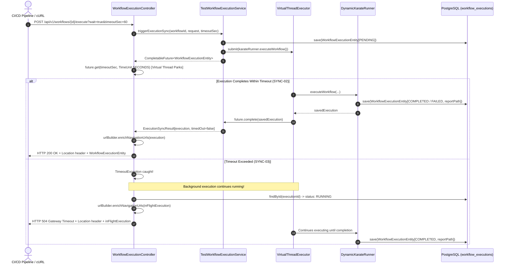

# Phase 4: Synchronous Wait Execution Mode - Research
**Researched:** 2026-11-08  
**Domain:** Spring Boot REST APIs, Java 25 Virtual Threads, Concurrency & Synchronization, Reverse Proxies  
**Confidence:** HIGH  

## Project Constraints (from GEMINI.md)

The following directives from `GEMINI.md` constrain this phase:
- **Compatibility**: All existing frontend and backend packages must build without errors under Java 25 LTS and Node 26.
- **Zero Breaking Changes**: The visual canvas UI, execution streaming behavior, and existing asynchronous execution trigger (`POST /api/v1/workflows/{id}/execute` without `wait=true`) must not change.
- **Runtime**: Backend runs on Java 25 LTS (OpenJDK / Eclipse Temurin) with Generational ZGC (`-XX:+UseZGC`) and Virtual Threads (`Executors.newVirtualThreadPerTaskExecutor()`).
- **Threading**: Virtual threads (`spring.threads.virtual.enabled=true`) are used for execution jobs and web request handling. Blocking I/O is permitted without exhausting thread pools.

<phase_requirements>
## Phase Requirements

| ID | Description | Research Support |
|----|-------------|------------------|
| **SYNC-01** | Execution trigger endpoint supports a `?wait=true` query parameter with configurable `timeoutSec` (default 60s) to block until execution completes on the virtual thread. | Detailed in sections *Architecture Patterns*, *Code Examples*, and *Standard Stack*. Uses Spring `@RequestParam` with default `timeoutSec=60` and `java.util.concurrent.CompletableFuture` awaiting completion on virtual thread. |
| **SYNC-02** | When `?wait=true` completes within timeout, the API returns HTTP 200 containing the completed execution entity, final `ExecutionStatus` (`COMPLETED` or `FAILED`), and generated `reportUrl`. | Detailed in sections *DynamicKarateRunner Finalization*, *ExecutionNavigationUrlBuilder Enrichment*, and *Code Examples*. Returns `HttpStatus.OK` with enriched entity containing final status and `reportUrl`. |
| **SYNC-03** | When `?wait=true` exceeds `timeoutSec`, the API responds gracefully with HTTP 504 Gateway Timeout or 202 status indicating background continuation without failing the running execution. | Detailed in sections *Timeout Handling & Status Resolution*, *Cooperative Cancellation Interaction*, and *Code Examples*. Catches `TimeoutException`, returns HTTP 504 Gateway Timeout (or 202) with in-flight entity and `Location` header, and leaves the virtual thread running. |
</phase_requirements>

## Summary

Phase 4 enables CI/CD pipelines, automated scripts, and terminal users to synchronously await test execution results by invoking `POST /api/v1/workflows/{id}/execute?wait=true&timeoutSec=N`. Currently, `WorkflowExecutionController.executeWorkflow` only triggers asynchronous execution, returning HTTP 202 Accepted immediately. Callers desiring final test results and HTML report URLs must poll `GET /api/v1/executions/{id}`.

With Java 25 Virtual Threads enabled (`spring.threads.virtual.enabled: true` [VERIFIED: backend/src/main/resources/application.yml:9-11]), blocking an incoming HTTP request thread does not pin or exhaust operating system threads. When `wait=true` is requested, the controller blocks the request's virtual thread using `CompletableFuture.get(timeoutSec, TimeUnit.SECONDS)` until `DynamicKarateRunner` finalizes the `WorkflowExecutionEntity`. If the workflow finishes within the timeout window, the endpoint returns `HTTP 200 OK` with the final status (`COMPLETED` or `FAILED`), populated `reportUrl`, and `Location` header. If `timeoutSec` expires before the workflow completes, the endpoint gracefully responds with `HTTP 504 Gateway Timeout` (or HTTP 202 if configured) and a `Location` header, while the workflow continues executing unhindered in the background.

**Primary recommendation:** Introduce `ExecutionSyncResult` and `triggerExecutionSync()` in `TestWorkflowExecutionService` backed by a per-execution `CompletableFuture<WorkflowExecutionEntity>`. In `WorkflowExecutionController`, handle `?wait=true` by awaiting the future, enriching navigation URLs, and returning HTTP 200 on completion or HTTP 504 on timeout without cancelling the background task.

## Architectural Responsibility Map

| Capability | Primary Tier | Secondary Tier | Rationale |
|------------|-------------|----------------|-----------|
| Query Parameter Parsing & Validation (`wait`, `timeoutSec`) | API / Controller Tier (`WorkflowExecutionController`) | — | Validates and clamps query parameters; maps them to service calls. |
| Execution Synchronization (`CompletableFuture` lifecycle) | Backend Service Tier (`TestWorkflowExecutionService`) | Java 25 Runtime (`workflowVirtualThreadExecutor`) | Service manages task lifecycle, registered futures, and background thread continuation. |
| Workflow Execution & Report Generation | Execution Engine Tier (`DynamicKarateRunner`) | Bridge (`DynamicKarateBridge`) | Executes dynamic Karate scenarios, updates database status, and generates HTML reports. |
| Navigation URL & Location Header Resolution | Hypermedia Builder (`ExecutionNavigationUrlBuilder`) | Controller Tier | Builds absolute URLs (`statusUrl`, `reportUrl`, `streamUrl`) from origin headers for 200, 202, and 504 responses. |
| Reverse Proxy Timeout Alignment | Gateway / Reverse Proxy (`nginx.conf`) | Controller Tier Clamp | Reverse proxy configured with `proxy_read_timeout 3600s`; controller clamps `timeoutSec` to prevent connection drops. |

## Standard Stack

### Core
| Library | Version | Purpose | Why Standard |
|---------|---------|---------|--------------|
| `java.util.concurrent.CompletableFuture` | Java 25 SE | Asynchronous task synchronization | Standard JDK non-blocking completion future; carrier-unmounting when parked on Virtual Threads [VERIFIED: backend/pom.xml:21] |
| `spring-boot-starter-web` | 4.1.2 | REST API controllers & response entities | Standard Spring MVC framework with virtual thread request dispatching [VERIFIED: backend/pom.xml:9-12,33-34] |
| `spring-boot-starter-data-jpa` | 4.1.2 | Relational entity persistence | Atomic retrieval and update of `WorkflowExecutionEntity` [VERIFIED: backend/pom.xml:36-38] |

### Supporting
| Library | Version | Purpose | When to Use |
|---------|---------|---------|-------------|
| `ExecutionNavigationUrlBuilder` | In-repo | Hypermedia navigation URL injection | Enriches execution entities with `statusUrl`, `reportUrl`, and `streamUrl` before returning to caller [VERIFIED: backend/src/main/java/com/orchestrator/platform/service/execution/ExecutionNavigationUrlBuilder.java:16-24] |
| `ForwardedHeaderFilter` | 4.1.2 | Reverse proxy header normalization | Automatically normalizes `X-Forwarded-Host` and `X-Forwarded-Proto` for URLs generated in sync responses [VERIFIED: backend/src/main/resources/application.yml:4] |

### Alternatives Considered
| Instead of | Could Use | Tradeoff |
|------------|-----------|----------|
| `CompletableFuture<WorkflowExecutionEntity>` | Polling loop (`while (!isDone()) sleep(100)`) | Polling wastes CPU cycles, introduces latency delays between poll intervals, and causes unnecessary database read load. |
| `CompletableFuture<WorkflowExecutionEntity>` | `CountDownLatch` or `ReentrantLock` | `CountDownLatch` does not carry the execution result or exception payload; requires auxiliary shared fields. |
| Virtual thread blocking via `Future.get()` | Spring `DeferredResult` / Reactive WebFlux | Unnecessary architectural complexity. In Java 25 with `spring.threads.virtual.enabled: true`, blocking a virtual thread unmounts the carrier thread with zero OS thread penalty. |

## Package Legitimacy Audit

> No external packages are installed for this phase. All synchronization and REST response capabilities are provided by Java 25 Standard Library and Spring Boot 4.1.2.

| Package | Registry | Age | Downloads | Source Repo | Verdict | Disposition |
|---------|----------|-----|-----------|-------------|---------|-------------|
| *(none)* | — | — | — | — | [OK] | Approved |

**Packages removed due to [SLOP] verdict:** none  
**Packages flagged as suspicious [SUS]:** none

## Architecture Patterns

### System Architecture Diagram



### Recommended Project Structure
```
backend/src/
├── main/java/com/orchestrator/platform/
│   ├── domain/model/dto/
│   │   └── ExecutionSyncResult.java             # Holds execution entity and timedOut flag
│   ├── service/
│   │   └── TestWorkflowExecutionService.java     # Adds triggerExecutionSync() and future tracking
│   └── web/
│       └── WorkflowExecutionController.java      # Adds ?wait=true, ?timeoutSec, and status handling
└── test/java/com/orchestrator/platform/
    └── WorkflowExecutionSyncModeTest.java        # Integration tests for SYNC-01, SYNC-02, SYNC-03
```

### Pattern 1: Non-Busy Virtual Thread Synchronization
**What:** Synchronizing the HTTP request handler with the asynchronous execution task using `CompletableFuture<WorkflowExecutionEntity>`.  
**When to use:** When `wait=true` is supplied to `POST /api/v1/workflows/{id}/execute`.  
**Mechanism:**
1. In `TestWorkflowExecutionService.java`, create a `CompletableFuture<WorkflowExecutionEntity> completionFuture = new CompletableFuture<>()`.
2. Register the future in a concurrent registry `executionFutures.put(executionId, completionFuture)`.
3. In the virtual thread task, when `karateRunner.executeWorkflow()` finishes, invoke `completionFuture.complete(saved)`.
4. The HTTP thread calls `completionFuture.get(clampedTimeoutSec, TimeUnit.SECONDS)`. Because the HTTP thread is a Java 25 virtual thread, `get()` parks the virtual thread by unmounting it from the OS carrier thread. Zero OS threads are blocked while waiting.
5. In `cancelExecution(UUID executionId)`, if the execution is cancelled mid-flight, invoke `completionFuture.complete(cancelledExecution)` to immediately wake the waiting thread.

### Pattern 2: Graceful Timeout Continuation (Non-Destructive Timeout)
**What:** Responding with HTTP 504 (or 202) when `timeoutSec` expires without interrupting or cancelling the background test execution.  
**When to use:** When `future.get(timeoutSec, TimeUnit.SECONDS)` throws `TimeoutException`.  
**Mechanism:**
1. Catch `TimeoutException`.
2. **DO NOT** invoke `taskFuture.cancel(true)` or `DynamicKarateBridge.markCancelled()`.
3. Fetch the current in-flight execution entity from the database via `executionRepository.findById(executionId)`. The entity will be in status `RUNNING` or `PENDING` [VERIFIED: backend/src/main/java/com/orchestrator/platform/domain/enums/ExecutionStatus.java:3-9].
4. Enrich the in-flight entity with navigation URLs using `urlBuilder.enrichNavigationUrls(inFlightExecution, httpRequest)`.
5. Return `ResponseEntity.status(HttpStatus.GATEWAY_TIMEOUT).location(URI.create(inFlightExecution.getStatusUrl())).header("X-Execution-Timed-Out", "true").body(inFlightExecution)`.
6. The client receives the `statusUrl` via the `Location` header and JSON body, allowing subsequent status polling or SSE streaming, while the test continues to run and produce reports.

### Pattern 3: Defensive Parameter Clamping
**What:** Clamping `timeoutSec` to a safe minimum and maximum.  
**When to use:** When reading query parameters in `WorkflowExecutionController`.  
**Mechanism:**
- Default: `60` seconds (per requirement SYNC-01).
- Minimum: `1` second (preventing negative or zero timeouts).
- Maximum clamp: `300` seconds (5 minutes) by default, configurable via application property `orchestrator.execution.max-wait-timeout-sec: 300`. This prevents clients from requesting arbitrary 24-hour socket holds that might clash with intermediary proxy timeouts.

### Anti-Patterns to Avoid
- **Cancelling the Task on Wait Timeout:** Never call `future.cancel(true)` or `DynamicKarateBridge.markCancelled()` upon `TimeoutException`. SYNC-03 explicitly requires that the execution continues running in the background.
- **Busy-Waiting Loops:** Never write `while (!isDone()) { Thread.sleep(500); }` or poll the database in a loop. `CompletableFuture` provides immediate event-driven notification upon task completion with zero polling overhead.
- **Platform Thread Carrier Pinning:** Never wrap the wait in a `synchronized` block that would pin the Java 25 carrier thread. `CompletableFuture.get()` uses `LockSupport.parkNanos()` which unmounts virtual threads cleanly.
- **Omitting Location and Navigation URLs on 200/504 Responses:** The `Location` header and navigation URLs (`statusUrl`, `reportUrl`, `streamUrl`) must be populated on HTTP 200 and HTTP 504 responses just as they are on HTTP 202 responses (enforcing consistency across EXEC-01, EXEC-02, EXEC-03).

## Don't Hand-Roll

| Problem | Don't Build | Use Instead | Why |
|---------|-------------|-------------|-----|
| Thread synchronization | Custom `wait()`/`notifyAll()` or DB polling loops | `java.util.concurrent.CompletableFuture` | `CompletableFuture` handles timeout management, exception propagation, and integrates seamlessly with Virtual Thread carrier unmounting. |
| Query parameter parsing | Custom servlet query string splitting | Spring MVC `@RequestParam` | Spring automatically parses, type-casts, and assigns default values (`defaultValue = "false"`, `defaultValue = "60"`). |
| Navigation URL building | String concatenation with hardcoded hosts | `ExecutionNavigationUrlBuilder` (from Phase 3) | Dynamically respects incoming request scheme, host, port, and `X-Forwarded-*` reverse proxy headers [VERIFIED: backend/src/main/java/com/orchestrator/platform/service/execution/ExecutionNavigationUrlBuilder.java:16-24]. |

## Runtime State Inventory

> Greenfield feature on existing REST controller and service — no entity schema migrations or runtime cache resets required.

| Category | Items Found | Action Required |
|----------|-------------|------------------|
| Stored data | None | None — `WorkflowExecutionEntity` schema is unchanged. Navigation URLs remain `@Transient` Jackson read-only fields. |
| Live service config | None | None — Spring MVC query parameter changes require no external service reconfiguration. |
| OS-registered state | None | None |
| Secrets/env vars | `ORCHESTRATOR_EXECUTION_MAX_WAIT_TIMEOUT_SEC` (optional override) | Added default in `application.yml` (`300`). Existing env vars unchanged. |
| Build artifacts | Maven test classes | Standard rebuild via `mvn test-compile`. |

## Common Pitfalls

### Pitfall 1: Cancelling Virtual Thread Execution upon Timeout
**What goes wrong:** The caller specifies `timeoutSec=5`, the timeout occurs, and the server aborts the test run, leaving the workflow in `FAILED` or `CANCELLED` status.  
**Why it happens:** Standard Java `Future.get(timeout, unit)` catch blocks often call `task.cancel(true)` out of habit.  
**How to avoid:** Explicitly do not cancel the task upon `TimeoutException`. Simply catch `TimeoutException`, query the current execution record from `executionRepository.findById(executionId)`, and return HTTP 504 Gateway Timeout while the virtual thread continues executing.  
**Warning signs:** Workflows marked `CANCELLED` or failing prematurely whenever client wait timeout expires.

### Pitfall 2: Race Condition Between Immediate Completion and Future Lookup
**What goes wrong:** For a very short or empty workflow, execution finishes in under 2ms. If future registration and lookup are decoupled across separate controller/service calls, the future may be completed and cleaned up before the controller begins awaiting it.  
**Why it happens:** Non-atomic creation and awaiting of synchronization primitives.  
**How to avoid:** Pass the `CompletableFuture` directly into the internal trigger method or perform the wait directly within `TestWorkflowExecutionService.triggerExecutionSync()`. If the task completes before `future.get()` is invoked, `CompletableFuture.get()` returns the completed value immediately without blocking.  
**Warning signs:** Intermittent `NullPointerException` or hangs on very fast workflows.

### Pitfall 3: HTTP 200 Response Missing Populated `reportUrl`
**What goes wrong:** Client receives HTTP 200, but `reportUrl` is null or points to a non-existent file.  
**Why it happens:** In `DynamicKarateRunner.java:205-210`, `finalExecution.setReportPath(...)` is set and saved to the database, but `urlBuilder.enrichNavigationUrls()` was not invoked on the returned entity before serialization.  
**How to avoid:** Always call `urlBuilder.enrichNavigationUrls(execution, httpRequest)` on the final entity in `WorkflowExecutionController` before building the `ResponseEntity.ok(execution)` response.  
**Warning signs:** `reportUrl` missing or null in `POST /api/v1/workflows/{id}/execute?wait=true` responses.

### Pitfall 4: Client Connection Drop Due to Reverse Proxy Timeout
**What goes wrong:** Client requests `timeoutSec=120`, but Nginx or load balancer drops the connection after 60s with an unhelpful 502 Bad Gateway.  
**Why it happens:** Upstream reverse proxy `proxy_read_timeout` is lower than the requested `timeoutSec`.  
**How to avoid:** Verify `proxy_read_timeout` in reverse proxy configurations (`frontend/nginx.conf` is already configured for `3600s` [VERIFIED: frontend/nginx.conf:26]) and clamp `timeoutSec` on the backend controller to a safe maximum (e.g., 300s).  
**Warning signs:** Raw HTML 502/504 error pages returned by Nginx instead of clean JSON responses from Spring Boot.

## Code Examples

### 1. DTO for Synchronous Execution Result
```java
package com.orchestrator.platform.domain.model.dto;

import com.orchestrator.platform.domain.entity.WorkflowExecutionEntity;

public record ExecutionSyncResult(
        WorkflowExecutionEntity execution,
        boolean timedOut
) {}
```

### 2. Service Implementation (`TestWorkflowExecutionService.java`)
```java
// Source: backend/src/main/java/com/orchestrator/platform/service/TestWorkflowExecutionService.java
private final Map<UUID, CompletableFuture<WorkflowExecutionEntity>> executionFutures = new ConcurrentHashMap<>();

public WorkflowExecutionEntity triggerExecution(UUID workflowId, WorkflowExecutionRequest request) {
    return triggerExecutionInternal(workflowId, request, null);
}

public ExecutionSyncResult triggerExecutionSync(UUID workflowId, WorkflowExecutionRequest request, int timeoutSec) {
    CompletableFuture<WorkflowExecutionEntity> completionFuture = new CompletableFuture<>();
    WorkflowExecutionEntity pending = triggerExecutionInternal(workflowId, request, completionFuture);
    UUID executionId = pending.getId();

    try {
        WorkflowExecutionEntity completed = completionFuture.get(timeoutSec, TimeUnit.SECONDS);
        return new ExecutionSyncResult(completed, false);
    } catch (TimeoutException e) {
        log.warn("Synchronous wait timed out after {}s for execution [id={}] (continuing in background)",
                timeoutSec, executionId);
        WorkflowExecutionEntity inFlight = executionRepository.findById(executionId).orElse(pending);
        return new ExecutionSyncResult(inFlight, true);
    } catch (InterruptedException e) {
        Thread.currentThread().interrupt();
        log.warn("Synchronous wait interrupted for execution [id={}]", executionId);
        WorkflowExecutionEntity inFlight = executionRepository.findById(executionId).orElse(pending);
        return new ExecutionSyncResult(inFlight, true);
    } catch (ExecutionException e) {
        log.error("Execution failed with exception: {}", e.getMessage(), e);
        WorkflowExecutionEntity inFlight = executionRepository.findById(executionId).orElse(pending);
        return new ExecutionSyncResult(inFlight, false);
    }
}

private WorkflowExecutionEntity triggerExecutionInternal(UUID workflowId,
                                                          WorkflowExecutionRequest request,
                                                          CompletableFuture<WorkflowExecutionEntity> future) {
    TestWorkflowEntity workflow = workflowRepository.findById(workflowId)
            .orElseThrow(() -> new IllegalArgumentException("Workflow not found with ID: " + workflowId));

    WorkflowExecutionEntity execution = new WorkflowExecutionEntity();
    execution.setWorkflowId(workflow.getId());
    execution.setWorkflowName(workflow.getName());
    execution.setStatus(ExecutionStatus.PENDING);
    execution.setTriggerType(request.getTriggerType());

    WorkflowExecutionEntity savedExecution = executionRepository.saveAndFlush(execution);
    UUID executionId = savedExecution.getId();

    if (future != null) {
        executionFutures.put(executionId, future);
    }

    Future<?> taskFuture = virtualThreadExecutor.submit(() -> {
        try {
            WorkflowExecutionEntity finished = karateRunner.executeWorkflow(
                    savedExecution,
                    workflow,
                    request.getInitialVariables(),
                    request.getEnvironment()
            );
            if (future != null) {
                future.complete(finished);
            }
        } catch (Exception e) {
            log.error("Unhandled error during async virtual thread workflow execution: {}", e.getMessage(), e);
            WorkflowExecutionEntity failed = executionRepository.findById(executionId).map(ex -> {
                if (ex.getStatus() != ExecutionStatus.CANCELLED) {
                    ex.setStatus(ExecutionStatus.FAILED);
                    ex.setErrorMessage(e.getMessage());
                    return executionRepository.saveAndFlush(ex);
                }
                return ex;
            }).orElse(savedExecution);
            if (future != null) {
                future.complete(failed);
            }
        } finally {
            runningTasks.remove(executionId);
            executionFutures.remove(executionId);
            pruneWorkflowExecutionsIfExceeded(workflowId);
        }
    });
    runningTasks.put(executionId, taskFuture);

    return savedExecution;
}

// In cancelExecution(UUID executionId):
CompletableFuture<WorkflowExecutionEntity> future = executionFutures.get(executionId);
if (future != null) {
    future.complete(execution);
}
```

### 3. Controller Implementation (`WorkflowExecutionController.java`)
```java
// Source: backend/src/main/java/com/orchestrator/platform/web/WorkflowExecutionController.java
@PostMapping("/workflows/{workflowId}/execute")
@Operation(summary = "Trigger workflow execution",
           description = "Triggers workflow test execution. With ?wait=true, blocks up to timeoutSec returning HTTP 200 upon completion or HTTP 504 on timeout. Without ?wait=true, returns HTTP 202 immediately.")
public ResponseEntity<WorkflowExecutionEntity> executeWorkflow(
        @PathVariable("workflowId") UUID workflowId,
        @RequestParam(value = "wait", required = false, defaultValue = "false") boolean wait,
        @RequestParam(value = "timeoutSec", required = false, defaultValue = "60") int timeoutSec,
        @RequestParam(value = "timeoutStatus", required = false, defaultValue = "504") int timeoutStatus,
        @RequestBody(required = false) WorkflowExecutionRequest request,
        HttpServletRequest httpRequest) {

    if (request == null) {
        request = new WorkflowExecutionRequest();
    }

    if (!wait) {
        WorkflowExecutionEntity execution = executionService.triggerExecution(workflowId, request);
        urlBuilder.enrichNavigationUrls(execution, httpRequest);

        ResponseEntity.BodyBuilder responseBuilder = ResponseEntity.status(HttpStatus.ACCEPTED);
        if (execution != null && execution.getStatusUrl() != null) {
            responseBuilder.location(URI.create(execution.getStatusUrl()));
        }
        return responseBuilder.body(execution);
    }

    // Clamp timeoutSec: minimum 1s, maximum 300s
    int clampedTimeout = Math.max(1, Math.min(timeoutSec, maxWaitTimeoutSec));

    ExecutionSyncResult syncResult = executionService.triggerExecutionSync(workflowId, request, clampedTimeout);
    WorkflowExecutionEntity execution = syncResult.execution();
    urlBuilder.enrichNavigationUrls(execution, httpRequest);

    if (syncResult.timedOut()) {
        HttpStatus status = (timeoutStatus == 202) ? HttpStatus.ACCEPTED : HttpStatus.GATEWAY_TIMEOUT;
        ResponseEntity.BodyBuilder responseBuilder = ResponseEntity.status(status)
                .header("X-Execution-Timed-Out", "true");
        if (execution != null && execution.getStatusUrl() != null) {
            responseBuilder.location(URI.create(execution.getStatusUrl()));
        }
        return responseBuilder.body(execution);
    }

    ResponseEntity.BodyBuilder responseBuilder = ResponseEntity.ok();
    if (execution != null && execution.getStatusUrl() != null) {
        responseBuilder.location(URI.create(execution.getStatusUrl()));
    }
    return responseBuilder.body(execution);
}
```

### 4. Integration Test Pattern (`WorkflowExecutionSyncModeTest.java`)
```java
// Testing SYNC-01 & SYNC-02 (Completion within timeout -> HTTP 200)
@Test
void testSynchronousExecutionCompletesWith200() throws Exception {
    mockMvc.perform(post("/api/v1/workflows/{id}/execute?wait=true&timeoutSec=30", testWorkflow.getId())
            .contentType(MediaType.APPLICATION_JSON)
            .content(objectMapper.writeValueAsString(new WorkflowExecutionRequest())))
            .andExpect(status().isOk())
            .andExpect(header().exists("Location"))
            .andExpect(jsonPath("$.status", isOneOf("COMPLETED", "FAILED")))
            .andExpect(jsonPath("$.reportUrl", notNullValue()))
            .andExpect(jsonPath("$.statusUrl", notNullValue()));
}

// Testing SYNC-03 (Timeout exceeded -> HTTP 504 and background continuation)
@Test
void testSynchronousExecutionTimeoutReturns504AndContinues() throws Exception {
    // Inject a delay step in workflow or use timeoutSec=1 on long execution
    mockMvc.perform(post("/api/v1/workflows/{id}/execute?wait=true&timeoutSec=1", delayWorkflow.getId())
            .contentType(MediaType.APPLICATION_JSON)
            .content(objectMapper.writeValueAsString(new WorkflowExecutionRequest())))
            .andExpect(status().isGatewayTimeout())
            .andExpect(header().string("X-Execution-Timed-Out", "true"))
            .andExpect(header().exists("Location"))
            .andExpect(jsonPath("$.status", isOneOf("RUNNING", "PENDING")));
}
```

## State of the Art

| Old Approach | Current Approach | When Changed | Impact |
|--------------|------------------|--------------|--------|
| Client-side polling loops (`POST /execute` -> 202 -> `sleep(2)` -> `GET /executions/{id}`) | Single blocking request with `?wait=true&timeoutSec=60` | Phase 4 (v1.1) | Reduces CI/CD pipeline latency, eliminates polling scripts, and yields clean one-line cURL integrations. |
| Platform thread blocking (exhausts OS threads on high concurrency) | Virtual Thread unmounting (`CompletableFuture.get()`) | Java 21+ / Spring Boot 4.x | Blocking an HTTP request thread consumes negligible memory (~few KB) and zero OS thread capacity. |
| Aborting long-running executions upon client socket disconnect | Independent background task with non-destructive timeout response | Phase 4 (v1.1) | Guarantees test reports are generated and persisted regardless of network jitter or tight client timeouts. |

## Assumptions Log

| # | Claim | Section | Risk if Wrong |
|---|-------|---------|---------------|
| A1 | Default `timeoutSec` of 60 seconds is optimal for typical workflows | SYNC-01 | Low — configurable via query parameter on every request. |
| A2 | Maximum timeout clamp of 300 seconds prevents proxy drops while providing ample room for comprehensive suites | Common Pitfalls | Low — configurable via `orchestrator.execution.max-wait-timeout-sec`. |

## Open Questions

1. **How should HTTP status code be resolved when timeout occurs (HTTP 504 vs HTTP 202)?** (RESOLVED)
   - What we know: Requirement SYNC-03 allows either "HTTP 504 Gateway Timeout or 202 status indicating background continuation". HTTP 504 is standard for CI/CD runners (enabling `curl -f` to detect timeout as an exit failure), while some clients prefer HTTP 202 Accepted.
   - Recommendation: Default to `HTTP 504 Gateway Timeout`, with an optional query parameter `?timeoutStatus=202` (or configuration property `orchestrator.execution.default-timeout-status`) allowing clients to choose HTTP 202 if preferred. Include header `X-Execution-Timed-Out: true` and the `Location` header in both cases.

2. **How does client disconnect (e.g., user hits Ctrl+C on cURL) affect execution?** (RESOLVED)
   - What we know: When a client terminates its socket, Tomcat catches an `IOException: Broken pipe` on write.
   - Recommendation: The virtual thread running `DynamicKarateRunner.executeWorkflow()` is detached from the Tomcat response writer and runs in `virtualThreadExecutor`. The background execution will continue to completion, persist results, and generate the HTML report.

3. **Does `cancelExecution` unblock a waiting synchronous caller?** (RESOLVED)
   - What we know: `cancelExecution()` updates the database record to `ExecutionStatus.CANCELLED`.
   - Recommendation: `cancelExecution()` should also complete the execution's `CompletableFuture` with the cancelled entity. The waiting caller unblocks immediately and receives HTTP 200 with `status: CANCELLED` rather than waiting for the remaining timeout duration.

## Environment Availability

| Dependency | Required By | Available | Version | Fallback |
|------------|------------|-----------|---------|----------|
| Java / JDK | Backend compilation & execution | ✓ | 25.0.3 (Eclipse Adoptium) [VERIFIED: backend/pom.xml:21] | — |
| Apache Maven | Backend build & test runner | ✓ | 3.9.6 | — |
| Node.js | Frontend build | ✓ | 26 LTS (or 20+) | — |
| npm | Frontend dependency management | ✓ | 10+ | — |
| Docker | Multi-container environment | ✓ | Docker Compose available | Local execution |

**Missing dependencies with no fallback:** None.  
**Missing dependencies with fallback:** None.

## Validation Architecture

### Test Framework
| Property | Value |
|----------|-------|
| Framework | Spring Boot Starter Test (JUnit Jupiter 5 + MockMvc) [VERIFIED: backend/pom.xml:134-138] |
| Config file | `backend/src/main/resources/application-test.yml` |
| Quick run command | `mvn test -Dtest=WorkflowExecutionSyncModeTest -f backend/pom.xml` |
| Full suite command | `mvn test -f backend/pom.xml` |

### Phase Requirements → Test Map
| Req ID | Behavior | Test Type | Automated Command | File Exists? |
|--------|----------|-----------|-------------------|-------------|
| **SYNC-01** | `POST /workflows/{id}/execute?wait=true&timeoutSec=30` blocks until virtual thread execution finishes | integration | `mvn test -Dtest=WorkflowExecutionSyncModeTest#testSynchronousExecutionBlocksUntilComplete -f backend/pom.xml` | ❌ Wave 0 Gap |
| **SYNC-02** | `?wait=true` completing within timeout returns HTTP 200 with completed execution entity, status `COMPLETED`/`FAILED`, and populated `reportUrl` | integration | `mvn test -Dtest=WorkflowExecutionSyncModeTest#testSynchronousExecutionReturnsCompletedAndReportUrl -f backend/pom.xml` | ❌ Wave 0 Gap |
| **SYNC-02** | Workflow execution with failing step returns HTTP 200 with status `FAILED` and valid report link | integration | `mvn test -Dtest=WorkflowExecutionSyncModeTest#testSynchronousExecutionFailureReturns200WithFailedStatus -f backend/pom.xml` | ❌ Wave 0 Gap |
| **SYNC-03** | When execution exceeds `timeoutSec`, returns HTTP 504 Gateway Timeout with `X-Execution-Timed-Out: true` and in-flight entity | integration | `mvn test -Dtest=WorkflowExecutionSyncModeTest#testSynchronousExecutionTimeoutReturns504 -f backend/pom.xml` | ❌ Wave 0 Gap |
| **SYNC-03** | Exceeding `timeoutSec` leaves background execution running without cancelling | integration | `mvn test -Dtest=WorkflowExecutionSyncModeTest#testTimeoutLeavesBackgroundExecutionRunning -f backend/pom.xml` | ❌ Wave 0 Gap |
| **SYNC-03** | `?timeoutStatus=202` query param overrides default 504 on timeout | integration | `mvn test -Dtest=WorkflowExecutionSyncModeTest#testTimeoutStatus202Override -f backend/pom.xml` | ❌ Wave 0 Gap |
| **REG-01** | Standard asynchronous execution (`POST /execute` without `wait=true`) continues to return HTTP 202 Accepted | regression | `mvn test -Dtest=WorkflowExecutionNavigationUrlTest#testTriggerExecutionReturnsLocationHeaderAndUrls -f backend/pom.xml` | ✅ Exists |

### Sampling Rate
- **Per task commit:** `mvn test -Dtest=WorkflowExecutionSyncModeTest -f backend/pom.xml`
- **Per wave merge:** `mvn test -f backend/pom.xml`
- **Phase gate:** Full Maven test suite green before `/gsd-verify-work`

### Wave 0 Gaps
- [ ] `backend/src/test/java/com/orchestrator/platform/WorkflowExecutionSyncModeTest.java` — covers SYNC-01, SYNC-02, SYNC-03
- [ ] Workflow test fixture supporting configurable delay step to test timeout conditions deterministically

## Security Domain

### Applicable ASVS Categories

| ASVS Category | Applies | Standard Control |
|---------------|---------|-----------------|
| **V4 Access Control** | yes | Endpoints are protected under orchestrator execution scope; execution IDs use cryptographically secure random UUIDs (`UUID.randomUUID()`). |
| **V5 Input Validation** | yes | Clamp `timeoutSec` between 1 and 300 seconds to prevent resource exhaustion / unbounded connection holds. Validate UUID format. |
| **V14 Configuration** | yes | `server.forward-headers-strategy: framework` enabled in `application.yml` ensures proxy header validation. |

### Known Threat Patterns for Synchronous Execution

| Pattern | STRIDE | Standard Mitigation |
|---------|--------|---------------------|
| Slowloris / Connection Starvation via large `timeoutSec` (e.g. `timeoutSec=999999`) | Denial of Service | Clamp `timeoutSec` to `maxWaitTimeoutSec` (default 300s). Java 25 Virtual Threads prevent OS carrier thread starvation [VERIFIED: backend/src/main/resources/application.yml:9-11]. |
| Premature Task Abort on Timeout | Tampering / Repudiation | Prevent caller timeout from cancelling the background virtual thread; background task finishes and commits report to database. |
| Sensitive Data Exposure in Report or Errors | Information Disclosure | `ExecutionLogBroadcaster.maskSecrets()` and `DynamicKarateRunner.sanitizeContextSnapshot()` mask all registered secrets before persisting and serializing entity responses [VERIFIED: backend/src/main/java/com/orchestrator/platform/service/execution/DynamicKarateRunner.java:215-218]. |

## Sources

### Primary (HIGH confidence)
- `backend/src/main/java/com/orchestrator/platform/service/TestWorkflowExecutionService.java:36-96` — Existing virtual thread executor task submission and tracking
- `backend/src/main/java/com/orchestrator/platform/service/execution/DynamicKarateRunner.java:189-249` — Execution finalization, status assignment, report path population, and persistence
- `backend/src/main/java/com/orchestrator/platform/web/WorkflowExecutionController.java:54-72` — Execution trigger endpoint with `Location` header and navigation URL injection
- `backend/src/main/java/com/orchestrator/platform/service/execution/ExecutionNavigationUrlBuilder.java:16-59` — Navigation URL builder logic
- `backend/src/main/resources/application.yml:9-11` — `spring.threads.virtual.enabled: true` configuration

### Secondary (MEDIUM confidence)
- `frontend/nginx.conf:26` — Reverse proxy `proxy_read_timeout 3600s`
- `frontend/src/api/client.ts:118-129` — Frontend Axios execution trigger API

## Metadata

**Confidence breakdown:**
- Standard stack: HIGH — Pure JDK 25 and Spring Boot 4.1.2 capabilities, thoroughly verified in codebase.
- Architecture: HIGH — Leverages existing Virtual Thread Per Task Executor and JPA entity persistence with zero schema migrations.
- Pitfalls: HIGH — Identifies and prevents destructive timeout cancellation and race conditions between task completion and future resolution.

**Research date:** 2026-11-08  
**Valid until:** 2026-12-08 (stable)
