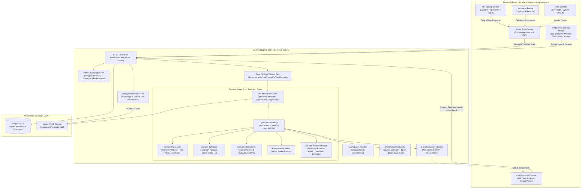

# MeterFlow: Self-Hosted E2E Test Orchestration Platform

[](https://openjdk.org/projects/jdk/25/)
[](https://spring.io/projects/spring-boot)
[](https://karatelabs.github.io/karate/)
[](https://react.dev/)
[-2496ED.svg?style=flat&logo=docker)](https://hub.docker.com/)
[](LICENSE)

> A production-ready, self-hosted end-to-end API & integration test orchestration platform inspired by **MeterSphere**, powered by a **Java 25 LTS** and **Spring Boot 4.1.2** backend with **Karate 2.1.4 DSL**, and a modern **React 19 + Vite + Tailwind + @xyflow/react** visual flow canvas.

---

## 🏛️ System Architecture



---

## ✨ Key Technical Capabilities

### 1. In-Memory Dynamic Karate 2.1.4 Execution Engine
- **No Temporary Files for Test Logic**: Employs a workflow-attributed feature generator that binds execution state in memory via `DynamicKarateBridge`.
- **Concurrency Locking**: Utilizes Karate scenario-level synchronization (`@lock=workflow-execution`) preventing race conditions during parallel runs.
- **Dynamic Branch Execution**:
  - `execute-http.feature`: Native Karate HTTP client executing dynamic URLs, verbs, headers, and payloads with JSONPath validation and retry polling.
  - `execute-db.feature`: Polls SQL databases through dynamic HikariCP connection pools for **PostgreSQL**, **Oracle DB (`ojdbc17`)**, and **H2** until expectations match or timeout expires.
  - `execute-kafka.feature`: Consumes Kafka topic events and verifies JSON schema within configured timeouts.
  - `execute-delay.feature`: Non-blocking virtual thread pauses for asynchronous event queues.
  - `execute-transform.feature`: Executes custom JavaScript expressions for HMAC tokens, UUIDs, date math, and context shaping.
- **Executive HTML Reports**: Produces isolated, searchable Karate HTML reports with full request/response bodies, cURL commands, and step profiling.

### 2. High-Performance Java 25 Virtual Threads & Execution Control
- Every test suite executes on lightweight **Java 25 Virtual Threads** (`Executors.newVirtualThreadPerTaskExecutor()`).
- Immediate `HTTP 202 Accepted` asynchronous execution response.
- **Mid-Flight Execution Abort / Cancellation**: Real-time cancellation via `POST /api/v1/executions/{id}/cancel` that safely interrupts the virtual thread, stops downstream steps, marks the execution status as `CANCELLED`, and broadcasts a WebSocket notification.

### 3. JavaScript Data Transform Node
- Dedicated violet visual node on the canvas.
- Allows authoring custom JS transformation functions:
  ```javascript
  function(ctx) {
    return {
      authToken: 'Bearer ' + ctx.rawToken,
      signature: 'HMAC_' + Math.random().toString(36).substring(7),
      epochTimestamp: Date.now()
    };
  }
  ```
- Evaluated within Karate's JS runtime; returned map properties are dynamically merged into the global workflow execution context.

### 4. Step Enable / Disable (Muting) & Step Retry Policy
- **Step Muting**: Toggle any step active or disabled directly from the configuration drawer. Muted steps are visually dimmed (`opacity-60`) with an amber `[Muted]` pill badge and cleanly skipped during test execution without deleting configurations.
- **Step Retry Policy**: Configurable retry attempts (1 to 5) and retry intervals (ms) on HTTP steps. Automatically translates into native Karate retry polling:
  ```gherkin
  * configure retry = { count: 3, interval: 1000 }
  * retry until responseStatus == 200
  * method get
  ```

### 5. Portability: Standalone Karate Export, JSON Backup, & CI/CD Webhooks
- **Karate `.feature` Export**: One-click download of a production-ready, standalone Karate Gherkin feature file (`/api/v1/workflows/{id}/export/feature`) that can be executed directly in CLI or CI pipelines.
- **Workflow JSON Export/Import**: Export clean JSON workflow definitions or import/clone existing workflows from JSON backups.
- **CI/CD Webhook Generator Modal**: Instant copy-pasteable cURL commands with environment selectors (`default`, `staging`, `production`) for GitHub Actions, GitLab CI, and Jenkins webhooks.

### 6. Granular HTTP Header Inheritance & Environment Secrets
- **Inheritance Modes per Step**:
  - `INHERIT_ALL`: Automatically merges workflow global headers with step-specific headers (step headers take precedence on collision).
  - `OVERRIDE_ALL`: Completely ignores workflow global headers and uses only the step's specific headers.
  - `CUSTOM_ONLY`: Explicit custom header list for high-security isolation.
- **Dynamic Secret Injection**: Reference host or container environment variables seamlessly: `${$env:API_KEY}`, `${$env:DATABASE_PASSWORD}`.

### 7. Storage Reclamation & Automated Report Retention Pruning
- **Automated Pruning**: Runs in the background upon workflow completion to keep only the latest $N$ executions per workflow (configured via `ORCHESTRATOR_RETENTION_MAX_RUNS_PER_WORKFLOW`, default: 3).
- **Disk Space Reclamation**: Automatically purges orphaned Karate report directories and cleans up old database records.
- **Storage Management Modal**: Inspect live disk usage statistics (`/api/v1/executions/storage-stats`) and perform one-click batch cleanups (`/api/v1/executions/cleanup`).

### 8. Canvas Auto-Layout Engine (Topological Alignment)
- Pure TypeScript implementation of **Kahn's Topological Sort Algorithm** (`layoutEngine.ts`).
- One-click **"Auto Align"** button in the canvas toolbar that automatically computes hierarchical level assignments and spaces nodes cleanly without overlap.

### 9. Modern React 19 Frontend & Theme Engine
- Built with **React 19**, **Tailwind CSS**, and **@xyflow/react** (React Flow).
- **Theme Mode Switcher**: Seamless switching between **Dark**, **Light**, and **System Default** modes with zero Flash of Unstyled Content (FOUC).
- **Optimized Bundle Splitting**: Modal components are dynamically code-split with Vite, keeping production chunk sizes under 165 kB with build times under 1.7 seconds.

---

## 🐳 Ultra-Optimized Docker Architecture

The backend Docker image is built for minimal size, fast cold starts, and production enterprise hardening:

| Metric | Before Optimization | After Optimization | Improvement |
| :--- | :--- | :--- | :--- |
| **Final Image Size** | **336 MB** | **191 MB** | **-145 MB (~43% reduction)** |
| **Java Runtime (JRE)** | 225 MB (`eclipse-temurin:25-jre-alpine`) | **55 MB** (Custom `jlink` JRE) | **-75% runtime footprint** |
| **Base Linux OS** | Standard Alpine + Full JRE | **`alpine:3.21` (7 MB)** | **Minimal attack surface** |
| **Rebuild Time (Code Changes)** | 1.5 – 3 minutes (re-packs 106MB jar) | **1.1 – 5.5 seconds** | **~95% faster builds** |
| **Registry Push Delta** | 106 MB on every commit | **~1.5 MB** (Application layer only) | **~98% less network transfer** |
| **Container Startup Time** | ~4.2 seconds (fat JAR unzipping) | **~3.1 – 4.0 seconds** (Unpacked `JarLauncher`) | **Faster cold starts** |
| **Shutdown Latency** | Often hits 10s `SIGKILL` | **0.510 seconds** (`exec java` signal forwarding) | **Instant graceful shutdown** |
| **Garbage Collection** | Default GC with warning | **Generational ZGC (`-XX:+UseZGC`)** | **Sub-millisecond pause times** |
| **Health Monitoring** | None (Blind container) | **`/actuator/health` probe** | **Native Docker `(healthy)` status** |
| **Security Privilege** | Root / Insecure | **`appuser:appgroup` (UID 10001)** | **Non-root least privilege** |

---

## 🚀 Quickstart Guide

### Option A: Run with Docker Compose (Recommended)

Clone the repository and spin up PostgreSQL, the Spring Boot backend, and the React frontend:

```bash
docker compose up --build -d
```

- **Frontend UI**: [http://localhost:3000](http://localhost:3000)
- **Backend API**: [http://localhost:8080](http://localhost:8080)
- **Actuator Health**: [http://localhost:8080/actuator/health](http://localhost:8080/actuator/health)
- **Swagger UI**: [http://localhost:8080/swagger-ui.html](http://localhost:8080/swagger-ui.html)
- **PostgreSQL**: `localhost:5432` (`user: postgres`, `password: postgres`, `db: e2e_orchestrator`)

---

### Option B: Run Locally from Source

#### Prerequisites
- **Java 25 LTS** (e.g. Temurin 25 or SDKMAN: `sdk install java 25.0.3-tem`)
- **Maven 3.9+**
- **Node.js 20+** and **npm**
- **PostgreSQL 16** running locally or via Docker:
  ```bash
  docker run -p 5432:5432 -e POSTGRES_PASSWORD=postgres -e POSTGRES_DB=e2e_orchestrator -d postgres:16-alpine
  ```

#### 1. Start Backend
```bash
cd backend
mvn clean spring-boot:run
```
*(The backend automatically creates schema tables and seeds demo microservice endpoints and a sample e-commerce checkout flow on first boot)*.

#### 2. Start Frontend
```bash
cd frontend
npm install
npm run dev
```
Open [http://localhost:5173](http://localhost:5173) in your browser.

---

## 🐳 Docker Hub Build & Deployment

### Multi-Architecture Support
Published images support both architectures natively out of the box:
- **`linux/arm64`**: Apple Silicon Mac (M1/M2/M3/M4) and ARM64 cloud servers.
- **`linux/amd64`**: Windows Docker Desktop (WSL2) and standard Intel/AMD Linux servers.

When pulling from Docker Hub, Docker automatically resolves and pulls the correct architecture slice without any emulation penalty.

---

### Automated CI/CD via GitHub Actions
A dedicated multi-platform GitHub Actions workflow is provided at [`.github/workflows/docker-publish.yml`](.github/workflows/docker-publish.yml).

#### Prerequisites
Configure two secrets in your GitHub repository (**Settings > Secrets and variables > Actions**):
- `DOCKERHUB_USERNAME`: Your Docker Hub username or organization.
- `DOCKERHUB_TOKEN`: Personal Access Token (PAT) with Read, Write, and Delete permissions.

#### Triggers
- **Push to `main`**: Automatically builds and publishes `:latest` and `:sha-<short-sha>` for both `linux/amd64` and `linux/arm64`.
- **Git Tags**: Creating a tag (e.g. `git tag v2.0.0 && git push origin v2.0.0`) automatically publishes SemVer tags (`:2.0.0`, `:latest`).
- **Manual Dispatch**: Go to **Actions > Build and Publish Multi-Platform Docker Images > Run workflow** to build custom tags (e.g., `staging`, `2.0.0`) or dry-run without pushing.

---

### Local CLI Build & Push
To build both frontend and backend Docker images locally and push them to your Docker Hub repository:

```bash
# Basic usage (defaults to tag: latest)
./docker-build-push.sh <your-dockerhub-username>

# With a specific version tag
./docker-build-push.sh <your-dockerhub-username> 1.0.0

# Multi-architecture build (linux/amd64 + linux/arm64) via Docker Buildx
./docker-build-push.sh <your-dockerhub-username> 1.0.0 --multi-arch
```

### Run Anywhere from Docker Hub
To run the platform on any server or machine without cloning source code or installing compilers:

```bash
# 1. Download the preconfigured compose file
curl -O https://raw.githubusercontent.com/Nikhil12894/e2e-orchestrator-platform/main/docker-compose.hub.yml

# 2. Run with Docker Compose (pulls published images automatically)
docker compose -f docker-compose.hub.yml up -d
```
The application will be live at:
- Frontend Canvas: [http://localhost:3000](http://localhost:3000)
- Backend Actuator Health: [http://localhost:8080/actuator/health](http://localhost:8080/actuator/health)


---

## 🧪 Running Tests

The test suite includes 23 automated tests covering the entire execution lifecycle, Karate bridge interop, and storage reclamation:

```bash
cd backend
mvn test
```

### Key Test Coverage
- `WorkflowFeaturesAndPortabilityTest`: Standalone Karate `.feature` export, JSON export/import, mid-flight cancellation, JS transform node variable injection, step muting, and step retry configuration.
- `DynamicKarateRunnerTest`: Multi-step end-to-end workflow execution with token extraction, variable chaining, status assertions, and HTML report generation.
- `ExecutionCleanupAndStorageReclamationTest`: Automated report directory deletion, disk reclamation calculation, and batch execution purging.
- `DbExecutorAndReportExclusionTest`: Multi-database query execution (PostgreSQL, Oracle DB, H2) and report exclusion flags.
- `WorkflowContextEngineTest`: Macro evaluation (`${$timestamp}`, `${$randomUuid}`), `${$env:VAR}` resolution, and JSONPath extraction.

---

## 📡 REST API Reference

### Workflow & Portability Endpoints
| Method | Endpoint | Description |
|---|---|---|
| `GET` | `/api/v1/workflows` | List all visual test workflows |
| `GET` | `/api/v1/workflows/{id}` | Fetch workflow canvas state and compiled AST |
| `POST` | `/api/v1/workflows` | Create a new test workflow |
| `PUT` | `/api/v1/workflows/{id}` | Update workflow canvas and recompile AST |
| `DELETE` | `/api/v1/workflows/{id}` | Delete workflow and cascade delete all its executions |
| `GET` | `/api/v1/workflows/{id}/export/feature` | Download standalone executable Karate `.feature` file |
| `GET` | `/api/v1/workflows/{id}/export/json` | Download workflow definition as clean JSON |
| `POST` | `/api/v1/workflows/import` | Import / clone workflow from JSON payload |

### Execution & Control Endpoints
| Method | Endpoint | Description |
|---|---|---|
| `POST` | `/api/v1/workflows/{id}/execute` | Trigger async execution via Virtual Threads (returns 202 Accepted) |
| `POST` | `/api/v1/executions/{id}/cancel` | Abort and cancel running virtual thread execution mid-flight |
| `GET` | `/api/v1/executions` | List execution history with pagination and status filters |
| `GET` | `/api/v1/executions/{id}` | Get execution status, context snapshot, and step results |
| `GET` | `/api/v1/executions/{id}/stream` | Server-Sent Events (SSE) live execution log stream |
| `GET` | `/api/v1/executions/{id}/report/**` | Serves isolated Karate HTML reports and static assets |
| `GET` | `/api/v1/executions/storage-stats` | Get total executions, disk space used, and report storage stats |
| `DELETE` | `/api/v1/executions/cleanup` | Delete old executions and reclaim disk space (`keepLastN` parameter) |

### System & Health Endpoints
| Method | Endpoint | Description |
|---|---|---|
| `GET` | `/actuator/health` | Container liveness & readiness probes (Docker healthcheck) |
| `GET` | `/actuator/info` | Application metadata and build info |

### Catalog Endpoints
| Method | Endpoint | Description |
|---|---|---|
| `POST` | `/api/v1/catalog/ingest` | Ingest OpenAPI spec from URL or raw YAML/JSON |
| `POST` | `/api/v1/catalog/seed-samples` | Seed demo microservices (Auth, Orders, Payments, Inventory) |
| `GET` | `/api/v1/catalog/endpoints` | Query endpoints with optional `serviceName` and `search` |
| `GET` | `/api/v1/catalog/services` | List distinct microservices |
| `DELETE` | `/api/v1/catalog/endpoints/{id}` | Delete an endpoint |

### Built-in Mock APIs (For Out-of-the-Box Testing)
| Method | Endpoint | Description |
|---|---|---|
| `POST` | `/api/v1/mock/auth/login` | Authenticate user & return JWT token |
| `POST` | `/api/v1/mock/orders` | Create an order with bearer authentication |
| `GET` | `/api/v1/mock/orders/{orderId}` | Fetch order details by order ID |
| `POST` | `/api/v1/mock/payments/charge` | Process payment |
| `GET` | `/api/v1/mock/inventory/{sku}` | Check stock levels |

---

## 📝 License
Apache License 2.0
