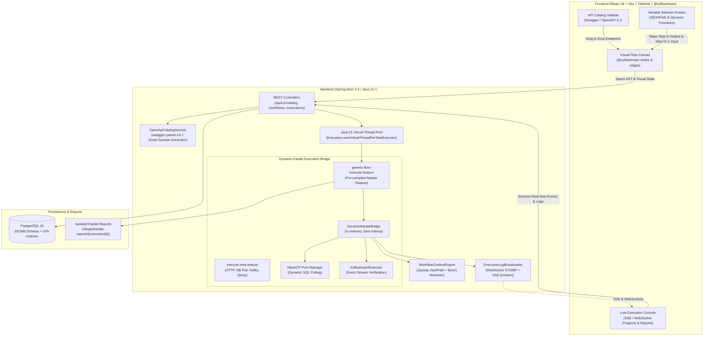

# MeterFlow: Self-Hosted E2E Test Orchestration Platform

> A production-ready, self-hosted end-to-end API & integration test orchestration platform inspired by **MeterSphere**, powered by a **Spring Boot 3 (Java 21+)** backend, an embedded **Karate DSL** execution engine, and a **React + Vite + @xyflow/react** visual flow canvas.

---

## 🏛️ System Architecture



---

## ✨ Key Technical Capabilities

### 1. In-Memory Dynamic Karate Execution Bridge
Unlike naive test runners that generate temporary `.feature` text files on disk for every test execution, **MeterFlow** employs a pre-compiled, generic master Karate suite:
- `generic-flow-executor.feature`: Receives the dynamic workflow JSON payload in memory, executes steps in topological sequence, and feeds extracted outputs back into the global context.
- `execute-step.feature`: Routes dynamically to specialized sub-features:
  - `execute-http.feature`: Native Karate HTTP client executing dynamic URLs, methods, headers, and request bodies with automatic status and schema validation.
  - `execute-db.feature`: Polls SQL databases through dynamic HikariCP connection pools until conditions evaluate to true (e.g. `row.status == 'COMPLETED'`) or timeouts expire.
  - `execute-kafka.feature`: Consumes and asserts message payloads from Kafka topics within specified timeouts.
  - `execute-delay.feature`: Pauses execution for asynchronous worker processing.
- **Official Karate HTML/JSON Reports**: Produces isolated, per-run Karate HTML reports containing full HTTP traces, timings, request/response headers, curl commands, and Gherkin step logs.

### 2. High-Performance Java 21 Virtual Threads
- All workflow executions are offloaded to **Java 21 Virtual Threads** (`Executors.newVirtualThreadPerTaskExecutor()`).
- Enables running hundreds of concurrent end-to-end integration test suites without thread exhaustion or OS context-switching overhead.
- Returns `HTTP 202 Accepted` immediately upon execution trigger.

### 3. OpenApiCatalogService with Intelligent Sample Payloads
- Ingests OpenAPI 3.0/3.1 and Swagger 2.0 specifications via URL or raw YAML/JSON.
- Recursively parses component schemas and `$ref` references.
- Auto-generates clean, realistic sample request payloads based on field heuristics (e.g. email, UUID, date-time, integer, boolean).
- Allows dragging any catalog endpoint directly onto the canvas to create pre-configured HTTP request nodes.

### 4. WorkflowContextEngine & Runtime Variable Chaining
- Resolves placeholders across steps using `${stepId.varName}` or direct JSONPath expressions:
  - `${step_auth.token}` $\rightarrow$ Extracted from previous step.
  - `${step_auth.response.body.user.id}` $\rightarrow$ Deep navigation.
  - `${$timestamp}` $\rightarrow$ Current epoch millis.
  - `${$isoTimestamp}` $\rightarrow$ ISO-8601 UTC date/time.
  - `${$randomUuid}` $\rightarrow$ Random UUID v4.
  - `${$randomInt(min, max)}` $\rightarrow$ Random integer in range.
  - `${$randomString(length)}` $\rightarrow$ Random alphanumeric string.
- Evaluates JSONPath queries via **Jayway JsonPath** with graceful null-safety.

### 5. PostgreSQL JSONB Data Layer
- `api_endpoint_catalog`: Stores endpoint metadata, tags, parameters, and generated sample payloads with GIN indexing.
- `test_workflows`: Stores visual canvas state (nodes, edges, viewport) and compiled executable AST.
- `workflow_executions`: Tracks asynchronous runs, status, context snapshots, per-step evaluations, and isolated report links.

### 6. Modern Visual Canvas & Live Execution Console
- Built with **React 18**, **Tailwind CSS**, and **@xyflow/react** (React Flow 12).
- Drag-and-drop nodes: HTTP Request, DB Poll, Kafka Assertion, and Delay.
- Animated edges showing data flow.
- Slide-over Node Configuration Drawer with integrated **Variable Selector Modal**.
- Collapsible Live Execution Console streaming real-time Server-Sent Events (SSE) and WebSocket logs.
- Embedded iframe viewer for the official Karate HTML report.

---

## 🚀 Quickstart Guide

### Option A: Run with Docker Compose (Recommended)

Clone the repository and spin up PostgreSQL, the Spring Boot backend, and the React frontend with a single command:

```bash
docker compose up --build -d
```

- **Frontend UI**: [http://localhost:3000](http://localhost:3000)
- **Backend API**: [http://localhost:8080](http://localhost:8080)
- **Swagger UI**: [http://localhost:8080/swagger-ui.html](http://localhost:8080/swagger-ui.html)
- **PostgreSQL**: `localhost:5432` (`user: postgres`, `password: postgres`, `db: e2e_orchestrator`)

---

### Option B: Run Locally from Source

#### Prerequisites
- **Java 21 LTS** (e.g. Temurin 21)
- **Maven 3.9+**
- **Node.js 20+** and **npm**
- **PostgreSQL** running locally or via Docker (`docker run -p 5432:5432 -e POSTGRES_PASSWORD=postgres -e POSTGRES_DB=e2e_orchestrator -d postgres:16-alpine`)

#### 1. Start Backend
```bash
cd backend
mvn clean spring-boot:run
```
*(The backend automatically creates schema tables and seeds demo microservice endpoints and a sample e-commerce checkout flow on first boot)*.

#### 2. Start Frontend
```bash
cd frontend
npm install
npm run dev
```
Open [http://localhost:5173](http://localhost:5173) in your browser.

---

## 🧪 Running Tests

The test suite includes full unit and integration tests executing Karate tests against the in-memory bridge:

```bash
cd backend
mvn test
```

Test coverage includes:
- `WorkflowContextEngineTest`: Placeholder resolution, dynamic macros, and Jayway JSONPath evaluation.
- `DynamicKarateRunnerTest`: Multi-step end-to-end workflow execution with token extraction, variable chaining, status assertions, and HTML report generation.

---

## 📡 REST API Reference

### Catalog Endpoints
| Method | Endpoint | Description |
|---|---|---|
| `POST` | `/api/v1/catalog/ingest` | Ingest OpenAPI spec from URL or raw YAML/JSON |
| `POST` | `/api/v1/catalog/seed-samples` | Seed demo microservices (Auth, Orders, Payments, Inventory) |
| `GET` | `/api/v1/catalog/endpoints` | Query endpoints with optional `serviceName` and `search` |
| `GET` | `/api/v1/catalog/services` | List distinct microservices |
| `DELETE` | `/api/v1/catalog/endpoints/{id}` | Delete an endpoint |

### Workflow Endpoints
| Method | Endpoint | Description |
|---|---|---|
| `GET` | `/api/v1/workflows` | List all visual test workflows |
| `GET` | `/api/v1/workflows/{id}` | Fetch workflow canvas state and compiled AST |
| `POST` | `/api/v1/workflows` | Create a new test workflow |
| `PUT` | `/api/v1/workflows/{id}` | Update workflow canvas and recompile AST |
| `DELETE` | `/api/v1/workflows/{id}` | Delete a workflow |

### Execution Endpoints
| Method | Endpoint | Description |
|---|---|---|
| `POST` | `/api/v1/workflows/{id}/execute` | Trigger async execution via Virtual Threads (returns 202) |
| `GET` | `/api/v1/executions` | List execution history |
| `GET` | `/api/v1/executions/{id}` | Get execution status, context snapshot, and step results |
| `GET` | `/api/v1/executions/{id}/stream` | Server-Sent Events (SSE) live execution log stream |
| `GET` | `/api/v1/executions/{id}/report/**` | Serves isolated Karate HTML reports and assets |

### Built-in Mock APIs (For Out-of-the-Box Testing)
| Method | Endpoint | Description |
|---|---|---|
| `POST` | `/api/v1/mock/auth/login` | Authenticate user & return JWT token |
| `POST` | `/api/v1/mock/orders` | Create an order with bearer authentication |
| `GET` | `/api/v1/mock/orders/{orderId}` | Fetch order details by order ID |
| `POST` | `/api/v1/mock/payments/charge` | Process payment |
| `GET` | `/api/v1/mock/inventory/{sku}` | Check stock levels |

---

## 📝 License
Apache License 2.0
